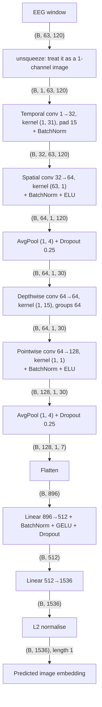
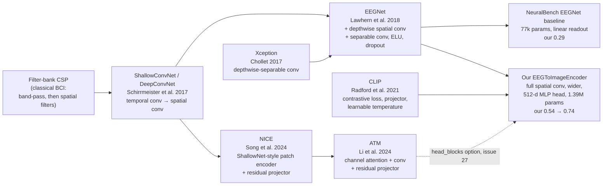
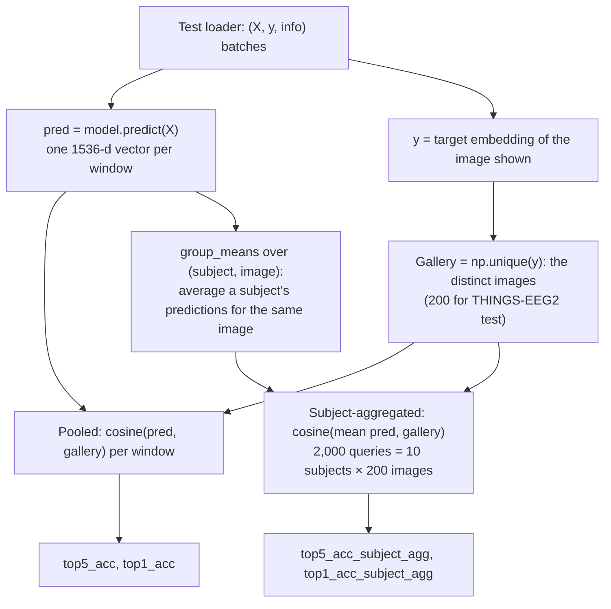
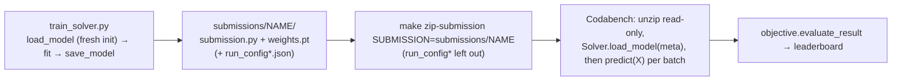
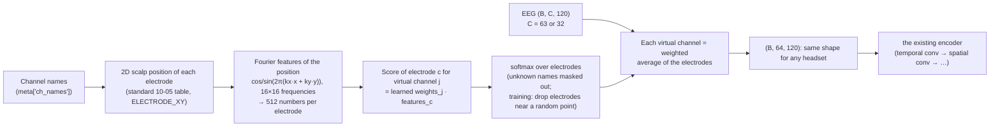
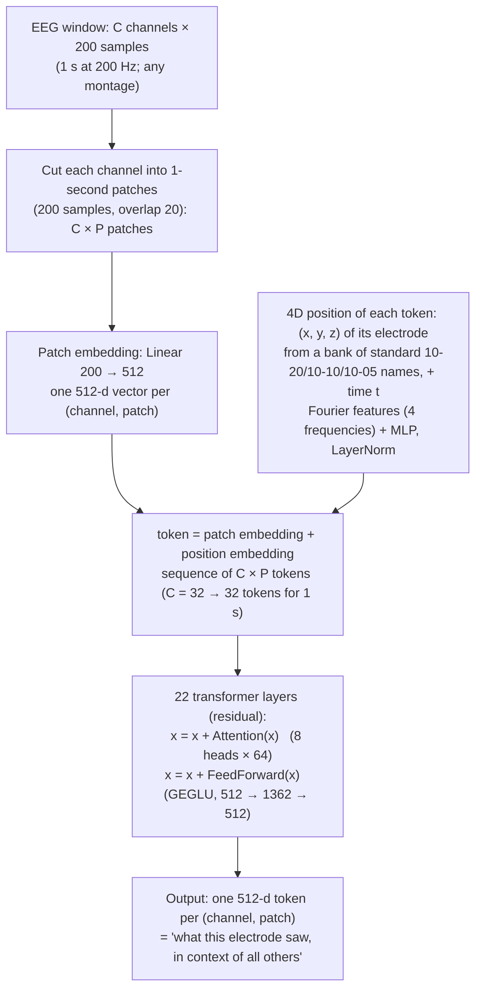
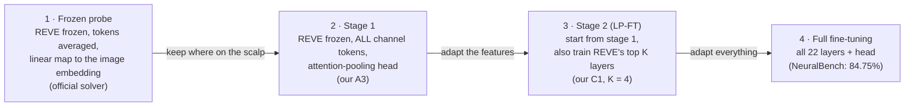
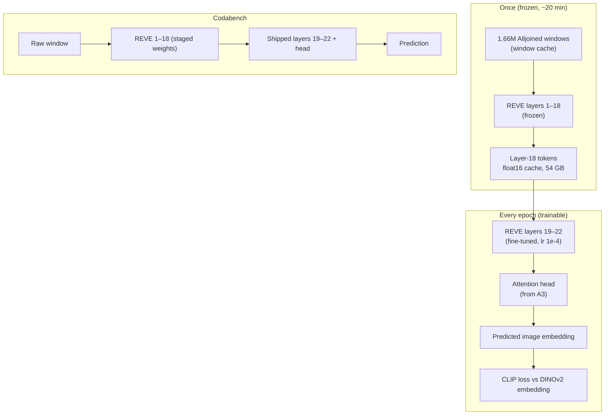
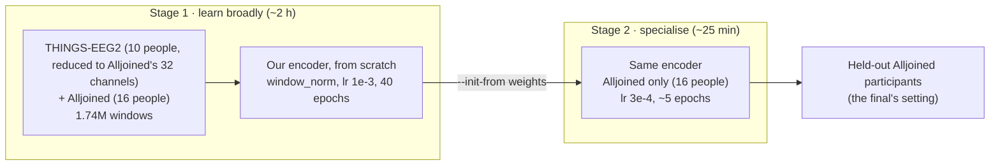

# Architecture deep dive: the model, the recipe, the evidence

This is the reference for teaching the project. It goes layer by layer through the model,
derives the loss, explains the evaluation, lists every experiment with its numbers, and maps
each idea to the paper it comes from.

- Start with [how_it_works.md](how_it_works.md) for the overview (task, data, big picture).
  This document assumes it and goes deeper.
- Code references are to commit `0e9ff1f` (2026-10-20) on branch `ws-m1-infra` (§9: `d3ed4ea`). Function and
  class names are stable; line numbers drift, so search for the name.
- Every number below comes from a file in the repo (`RESULTS.md`, `logs/`, `submissions/*/run_config*.json`)
  or from a script run on the model. Anything that couldn't be checked is marked **(unverified)**.

Contents
1. [The encoder, layer by layer](#1-the-encoder-layer-by-layer)
2. [Where the encoder comes from (lineage and history)](#2-where-the-encoder-comes-from)
3. [The loss and the training recipe](#3-the-loss-and-the-training-recipe)
4. [Evaluation in detail](#4-evaluation-in-detail)
5. [Every experiment and its result](#5-every-experiment-and-its-result)
6. [Submission and inference path](#6-submission-and-inference-path)
7. [Paper map and bibliography](#7-paper-map-and-bibliography)
8. [Teaching kit](#8-teaching-kit)
9. [Next: new people and new headsets (in progress)](#9-next-new-people-and-new-headsets-in-progress)
10. [Unseen participants and Alljoined: results and new tools (Oct 21–22)](#10-unseen-participants-and-alljoined-results-and-new-tools-oct-2122)
11. [Fine-tuning REVE, a foundation model for EEG](#11-fine-tuning-reve-a-foundation-model-for-eeg)
12. [Two-stage training and the final ensemble](#12-two-stage-training-and-the-final-ensemble)
13. [Cross-validation over participants: the honest estimate](#13-cross-validation-over-participants-the-honest-estimate)

---

## 1. The encoder, layer by layer

`EEGToImageEncoder` in `submission/submission.py`. One input window is a matrix of
**63 electrodes × 120 time samples** (1 s at 120 Hz, from −0.2 s to +0.8 s around image onset).
The output is one **unit-length 1536-d vector** in DINOv2-giant's embedding space.

### 1.1 The whole network at a glance



### 1.2 Layer table (computed, not estimated)

Shapes and parameter counts were produced by running the class on a `(2, 63, 120)` input on
CPU (script in exercise 1, §8.3).

| # | Module (exact PyTorch) | Shape in → out | Parameters |
|---|---|---|---|
| 1 | `Conv2d(1, 32, kernel_size=(1, 31), padding=(0, 15), bias=False)` | (B,1,63,120) → (B,32,63,120) | 992 |
| 2 | `BatchNorm2d(32)` | same | 64 |
| 3 | `Conv2d(32, 64, kernel_size=(63, 1), groups=1, bias=False)` | (B,32,63,120) → (B,64,1,120) | **129,024** |
| 4 | `BatchNorm2d(64)` · `ELU()` | same | 128 |
| 5 | `AvgPool2d((1, 4), stride=(1, 4))` · `Dropout(0.25)` | (B,64,1,120) → (B,64,1,30) | 0 |
| 6 | `Conv2d(64, 64, kernel_size=(1, 15), padding=(0, 7), groups=64, bias=False)` | (B,64,1,30) → same | 960 |
| 7 | `Conv2d(64, 128, kernel_size=(1, 1), bias=False)` | (B,64,1,30) → (B,128,1,30) | 8,192 |
| 8 | `BatchNorm2d(128)` · `ELU()` | same | 256 |
| 9 | `AvgPool2d((1, 4), stride=(1, 4))` · `Dropout(0.25)` | (B,128,1,30) → (B,128,1,7) | 0 |
| 10 | `flatten` | (B,128,1,7) → (B,896) | 0 |
| 11 | `Linear(896, 512)` | (B,896) → (B,512) | **459,264** |
| 12 | `BatchNorm1d(512)` · `GELU()` · `Dropout(0.25)` | same | 1,024 |
| 13 | `Linear(512, 1536)` | (B,512) → (B,1536) | **787,968** |
| 14 | `F.normalize(p=2, dim=-1)` | same | 0 |
| | **Total** | | **1,387,872** |

**Where the parameters are:** the convolutional "feature extractor" (layers 1–9) has 139,616
parameters (10%); the projection head (11–13) has 1,248,256 (90%). The network is mostly a
mapping from 896 EEG features to DINOv2 space. The single biggest conv layer is the spatial
one (129k), because every output filter sees all 32 temporal maps on all 63 electrodes.

Size variants from #27 (`temporal_filters`, `spatial_filters`, `sep_filters`, `hidden_dim`,
`head_blocks`), also computed: wider convs 64/128/256 → 2.26M; head 1024 + 1 residual block →
5.00M; both → 6.33M.

### 1.3 What each layer does, and why

**Input reshaping.** EEG is not an image: one axis is space (electrodes), the other is time.
Treating it as a 1-channel image `(1, 63, 120)` lets us use 2-D convolutions whose kernels
are 1-D in one axis: `(1, k)` kernels act **along time only**, `(63, 1)` kernels **across
electrodes only**. This "factorised" spatio-temporal design is the core idea of
ShallowConvNet / DeepConvNet (Schirrmeister et al., 2017) and EEGNet (Lawhern et al., 2018).

**1–2. Temporal convolution (32 filters × 31 taps) + BatchNorm.**
- Each filter is a **learned FIR filter** applied identically to every electrode (the kernel is
  `(1, 31)`, so it slides along time and is shared across rows).
- 31 taps at 120 Hz span **258 ms**. A filter of that length can isolate frequency bands about
  120/31 ≈ 4 Hz wide anywhere between 0 and the 60 Hz Nyquist limit: theta (4–8 Hz), alpha
  (8–13 Hz), beta, or act as a matched filter for the shape of an evoked response.
- `padding=15` keeps the 120 samples ("same" convolution). The first and last 15 samples are
  computed against zero padding, so the window edges are slightly less reliable.
- `bias=False` because the BatchNorm right after has its own shift.
- **BatchNorm2d** (Ioffe & Szegedy, 2015) standardises each filter's output over the batch,
  electrodes and time, which keeps training stable at a high learning rate.
- Lineage: EEGNet uses 8 filters of half the sampling rate (64 taps at 128 Hz ≈ 500 ms);
  ShallowConvNet uses 40 filters of 25 taps at 250 Hz (100 ms). Ours sits in between, with
  more filters.

**3–4. Spatial convolution (64 filters spanning all 63 electrodes) + BatchNorm + ELU.**
- Kernel `(63, 1)`: each output is a **weighted sum over all electrodes** at one time point.
  This is a learned **spatial filter**, the deep-learning version of classical techniques like
  Common Spatial Patterns (CSP), beamformers, or picking an ICA component: it can, for example,
  weight the occipital electrodes positively and subtract a frontal reference.
- `groups=1` means each of the 64 spatial filters mixes **all 32 temporal maps**: it combines
  frequency bands and electrodes jointly (32 × 63 = 2,016 weights per filter). EEGNet instead
  uses a **depthwise** spatial conv (each spatial filter sees only one temporal map, `D = 2`
  spatial filters per temporal filter, 63 weights each, with a max-norm constraint). Ours has
  many more parameters here (129k vs EEGNet's 1,008 at the same input size).
  *Note:* the original scaffold's comment calls this layer "depthwise" but the code has always
  used `groups=1` (commit `db3fb74`); the code is what ran in every experiment.
- The kernel height is the channel count, so **the layer is tied to 63 electrodes in a fixed
  order**. That's why a THINGS-EEG2 model can't run on the final phase's 32 Emotiv channels
  without retraining (see issue #21 and the planned position-based spatial attention).
- **ELU** (exponential linear unit, Clevert et al., 2016) is smooth for negative inputs;
  EEGNet and ShallowConvNet-family models use it.

**5. Average pooling (×4) + Dropout.**
- 120 → 30 time steps: an average over 4 samples is a crude **low-pass filter followed by
  downsampling** to 30 Hz (33 ms per step). Evoked visual responses are slow (most power below
  ~20 Hz), so little is lost and later layers become cheaper and see longer stretches of time.
- **Dropout 0.25** randomly zeroes 25% of activations during training (Srivastava et al.,
  2014). EEGNet's paper recommends 0.25 for cross-subject training (0.5 within-subject)
  **(from memory of the EEGNet paper; braindecode's default is 0.25)**.

**6–8. Depthwise-separable convolution + BatchNorm + ELU.**
- **Depthwise** (layer 6): each of the 64 maps gets its **own** 15-tap temporal filter
  (`groups=64`, 960 weights). At 30 Hz, 15 taps span **500 ms**: it summarises how each
  spatial component evolves over half a second.
- **Pointwise** (layer 7): a 1×1 conv that mixes the 64 maps into 128 (8,192 weights).
- Splitting "filter in time" from "mix the maps" is a **depthwise-separable convolution**
  (Chollet, Xception, CVPR 2017), adopted by EEGNet to use far fewer parameters than a full
  conv (a full 64→128 conv with 15 taps would need 122,880 weights instead of 9,152).

**9. Average pooling (×4) + Dropout.** 30 → 7 time steps (30/4 = 7.5, floored: the last two
30 Hz steps are not pooled, though their information still reaches step 6 through the
depthwise kernel). Each final step represents 16 input samples = **133 ms**.

**10. Flatten → 896 features.** 128 maps × 7 time steps. Flattening (rather than averaging
over time) keeps **when** each feature occurred: the next layer has separate weights for
"component 12 at 100–233 ms" and "component 12 at 500–633 ms". That matters because the
timing of visual responses carries information. It is also our best explanation for why
random time-shift augmentation hurt (R4, §5).

**Receptive field of the final features.** Following the layers back to the input:
temporal conv (31) → pool (stride 4) → depthwise conv (15 at stride 4) → pool (stride 16).
Each of the 7 final time steps sees **102 input samples = 850 ms**, and consecutive steps are
**133 ms apart**. Step 0 covers roughly −200 → +283 ms around image onset; step 6 roughly
+242 → +792 ms. So every final feature integrates most of the window, with a different
centre of gravity: early steps emphasise the first visual responses (~100–200 ms), late
steps the later, more semantic activity.

**11–13. Projection head.** `Linear(896→512) → BatchNorm1d → GELU → Dropout → Linear(512→1536)`.
- A two-layer MLP that maps EEG features into DINOv2's 1536-d space. Using an MLP
  "projector" between the encoder and the contrastive loss is the standard recipe in
  contrastive learning (CLIP uses linear projections; SimCLR showed a non-linear head helps).
- **GELU** (Hendrycks & Gimpel, 2016) is a smooth ReLU used in transformers.
- It's 90% of the model. The NeuralBench EEGNet baseline instead reads 48 features (16 maps ×
  3 time steps) straight into 1536 outputs with a single linear layer; that "bigger head" is
  one of the two changes `RESULTS.md` credits for our jump from 0.30 to 0.54 (§2.2).
- Optional (#27): `head_blocks` adds residual blocks `x + Dropout(Linear(GELU(x)))` on the
  1536-d output followed by `LayerNorm`, as in ATM's projector (Li et al., 2024). Off by
  default; R13/R14 in the queue test it.

**14. L2 normalisation.** Divides the output by its length so it lies on the unit sphere.
The metric ranks by **cosine similarity**, which only depends on direction, and the loss
normalises the targets too, so predictions and targets are compared purely by angle.

---

## 2. Where the encoder comes from

### 2.1 Family tree



- **Filter-bank CSP** is the classical pipeline for EEG decoding: band-pass filter the signal
  into several frequency bands, learn spatial filters per band, then classify the log-power.
- **ShallowConvNet** (Schirrmeister et al., 2017) turned that into a network: temporal conv
  (40 filters × 25 taps) → spatial conv (40) → squaring → mean pooling (75, stride 15) → log
  → classifier, i.e. a learnable filter-bank CSP. **DeepConvNet** stacks four conv-pool blocks.
  (Defaults verified in braindecode's `ShallowFBCSPNet`: 40 / 25 / 40 / 75 / 15.)
- **EEGNet** (Lawhern et al., 2018) made it compact: temporal conv (F1 = 8 filters, 64 taps)
  → depthwise spatial conv (D = 2 per temporal filter, max-norm constrained) → BatchNorm, ELU,
  average pooling, dropout → separable conv (F2 = 16) → pooling → classifier. (Defaults
  verified in braindecode's `EEGNet`: F1 = 8, D = 2, F2 = F1·D, kernel 64, depthwise kernel 16,
  dropout 0.25.)
- **Our encoder** keeps EEGNet's block order and its separable conv, but uses 4× more
  temporal filters (32), a **full** (non-depthwise, unconstrained) spatial conv with 64
  filters, 128 separable maps, a shorter temporal kernel (31 taps at 120 Hz), and replaces
  the classifier with a 2-layer **projection head** into DINOv2 space trained with a CLIP loss.
- **NICE** (Song et al., ICLR 2024) and **ATM** (Li et al., NeurIPS 2024) are the THINGS-EEG2
  state of the art that issue #12 targets. From the papers and their public code, roughly
  **(unverified in detail; check the papers' architecture figures)**: NICE's encoder is a
  ShallowNet-style temporal conv → average pooling → spatial conv producing a short sequence
  of patch embeddings, then a projector `Linear → residual(GELU, Linear, Dropout) → LayerNorm`;
  NICE-GA adds graph attention over electrodes. ATM adds a channel-wise transformer embedding
  (with a subject token) before a similar conv block and residual projector. Our `head_blocks`
  option is that residual projector.

### 2.2 The true history (from git)

| Date | Commit | What happened |
|---|---|---|
| 2026-09-11 | `db3fb74` | Initial scaffold. `src/models/eeg_encoder.py` defines the architecture as **learning TODOs** "based on EEGNet principles": temporal conv (1, 31) × 32 → spatial conv (n_chans, 1) × 64 → separable conv → 512-d projection head → 1536, L2-normalised. The layer sizes we still use were fixed here. |
| 2026-09-13 | `7d7dc1e` | TODOs completed ("complete TODOs for setup"). |
| 2026-10-17/18 | `6896932`, `bf5bf17` | `submission/submission.py` made self-contained (torch only) and fixed for the Codabench contract; state_dict keys match `src/models/eeg_encoder.py`. |
| 2026-10-18 | `7b439e0` | **First real upload: NeuralBench's own EEGNet** (official template), 0.29. |
| 2026-10-19 | `da20e91`, `c652e3a` | Our encoder trained on THINGS-EEG2 with InfoNCE: **0.54** (held-out 42.15%). Seeded training and `weights_*.pt` ensembling added. |
| 2026-10-19 | `5facb9b` | Training options for the round-1 experiments (`learn_temperature`, `dedup`, `symmetric`, augmentation) and `--set` overrides. |
| 2026-10-19 | `1a8fc30`, `41b152e`, `2fb5a51` | Learnable temperature (+10 held-out), `--use-val` (+3.5). |
| 2026-10-20 | `e34d3f1` | Final 3-seed ensemble on all concepts: 73.80% test, **0.74** on Codabench. |
| 2026-10-20 | `18992e0`, `424c9b5` | Per-epoch held-out scoring + early stopping (#15); repetition averaging (#17). |
| 2026-10-20 | `e893e30`, `c5881bd`, `48925dd` | Schedule / weight decay / dropout settings (#18); encoder size settings, sizes read back from weights (#27); `min_temperature`. |
| 2026-10-20 | `68d2b65`, `0e9ff1f` | Window cache (#14); per-epoch checkpoints and `--resume`; pause/resume. |

**Why our encoder beat the NeuralBench baseline by 24 points** (`RESULTS.md`: "bigger head,
10× higher lr"). The baseline's configuration (`submissions/neuralbench_eegnet_things_eeg2_seed34/run_config.yaml`)
versus ours:

| | NeuralBench EEGNet (0.29–0.30) | Our encoder (0.54) |
|---|---|---|
| Network | braindecode EEGNet defaults (F1 8, D 2, F2 16, kernel 64), **77k parameters** (counted from the shipped weights) | 1.39M parameters |
| Readout | one linear layer: 48 features (16 maps × 3 steps) → 1536 | 896 features → 512 → 1536 MLP |
| Optimiser | AdamW, **lr 1e-4**, weight decay 0.05, OneCycle schedule | AdamW, **lr 1e-3**, weight decay 1e-4, constant |
| Batch | 64 | 256 (4× more negatives per step) |
| Loss | NeuralBench `ClipLoss`, fixed temperature | our `clip_loss`, τ = 0.07 fixed (learnable later) |
| Stopping | 40 epochs, patience 5 on a validation rank metric | 20 epochs |

We never ran the ablation that separates these factors, so the split between "bigger head",
"higher lr" and "bigger batch" is **not measured**.

---

## 3. The loss and the training recipe

All in `Solver.fit` and `clip_loss` in `submission/submission.py`, driven by
`scripts/train_solver.py`.

### 3.1 The contrastive (InfoNCE / CLIP) loss

For a batch of $B$ windows, let $p_i$ be the model's unit-length prediction for window $i$
and $t_i$ the DINOv2 embedding of the image that window shows (normalised inside the loss).
The similarity matrix is $s_{ij} = p_i \cdot t_j$ (cosine). With temperature $\tau$:

$$
\mathcal{L} = -\frac{1}{B}\sum_{i=1}^{B} \log \frac{\exp(s_{ii}/\tau)}{\sum_{j=1}^{B}\exp(s_{ij}/\tau)}
$$

Read it as a **B-way classification per row**: "which of the B images in this batch did EEG
window $i$ see?" The correct answer is the diagonal; the other $B-1$ images in the batch are
the **negatives** ("in-batch negatives"), so no extra sampling is needed. Minimising it pulls
$p_i$ towards $t_i$ and pushes it away from the other targets, which is exactly what top-k
retrieval rewards. This is **InfoNCE** (van den Oord et al., 2018), popularised by **CLIP**
(Radford et al., 2021), and used for brain decoding by Défossez et al. (2023), NICE, ATM.

Why not regression (minimise $\|p_i - t_i\|^2$)? A regression model facing noisy input
predicts the conditional mean, a blurry "average image" that sits close to everything and
ranks poorly. #23's post-hoc ridge maps confirmed it: fitted by squared error, they scored
0.046–0.052 held-out (§5).

**Options tested in round 1:**
- `symmetric=True` adds the column-wise term (for each image, which EEG window matches?),
  as in CLIP. No gain here (R3).
- `dedup=True` masks out "false negatives": other windows in the batch that show the **same**
  image (each training image has ~40 windows: 10 subjects × 4 repetitions). With ~14.5k
  training images and batch 256, a batch contains only about 2 such pairs on average
  **(our estimate)**, which explains why it made no difference (R1: 41.20% vs 41.35%).

### 3.2 The temperature

$\tau$ divides the similarities before the softmax. Small $\tau$ makes the softmax sharp, so
the loss concentrates on the hardest negatives (images that look most like the right one).
- Fixed at **0.07** at first (a common default).
- **Learnable** (`learn_temperature=True`), parameterised as CLIP does: the trainable
  parameter is $\log(1/\tau)$ (initialised to $\log(1/0.07) \approx 2.66$) and it is clamped
  at $\log 100$, i.e. **$\tau \ge 0.01$** ("logit scale at most 100"). It's trained with the
  model by the same optimiser.
- Effect: **+10 points held-out** (R2: 41.35% → 51.75%), the biggest single gain.
- In R6 the learned $\tau$ fell from 0.027 (epoch 1) to the **0.01 floor by epoch ~15** and
  stayed there. R15 lowered the floor to 0.005 (`min_temperature`): $\tau$ went to 0.0072,
  but held-out trailed R6 at every comparable epoch (best 0.564 vs 0.582 by epoch 31) when a
  restart stopped it at epoch 32. **Conclusion: no gain**, floor stays at 0.01.

### 3.3 Optimisation

| Setting | Value | Notes / source |
|---|---|---|
| Optimiser | **AdamW** | Adam with decoupled weight decay (Loshchilov & Hutter, ICLR 2019) |
| Learning rate | **1e-3** | 10× the NeuralBench baseline |
| Weight decay | **1e-4** | `weight_decay` setting (#18); applied to the temperature parameter too (negligible) |
| Batch size | **256** | `--batch-size`; more negatives per step. R10/R11 test 512 / 1024 with linearly scaled lr (Goyal et al., 2017) |
| Gradient clipping | max norm **1.0** | stabilises early training |
| Schedule | constant (default); `lr_schedule='cosine'` + `warmup_epochs` | Cosine decay from SGDR (Loshchilov & Hutter, ICLR 2017); linear warm-up from Goyal et al. 2017. Applied per step via `LambdaLR` |
| Epochs | 20 originally; **40** in R6 (+3.75 held-out) | longer training still improving at 40 |
| Dropout | 0.25 | `dropout` setting |
| Seed | `--seed` | seeds weight init, shuffling and dropout |

### 3.4 Data-side recipe

- **More data (`--use-val`, #16):** NeuralBench's own "val" split of THINGS-EEG2 is ordinary
  training data (same concepts). Adding it gives +25% windows (470,140 → 587,574 with the
  held-out concepts removed; 668,400 for final models on all concepts): **+3.5 held-out**.
- **Augmentation (R4):** random circular time shift up to ±6 samples (±50 ms) and 10% channel
  dropout. It **hurt badly** (49.85% → 36.80%). Our interpretation **(hypothesis, not
  tested)**: the flattened readout uses absolute timing (§1.3, layer 10), the circular roll
  wraps the end of the window onto the start, and 50 ms is large relative to visual response
  latencies.
- **Repetition averaging (`--avg-reps K`, #17, Gifford et al. averaged repetitions too):**
  each training item becomes the mean of K repetitions of the same (subject, image), which
  cuts independent noise by about $\sqrt{K}$. With `--avg-reps-random` K is drawn from 1..K
  per item, mixing clean and noisy examples (test inputs are single trials). There are 145,400
  (subject, image) groups, so an "epoch" is **4× shorter** than with single windows.
  **Caveat:** early stopping counts epochs, so patience 5 is effectively 4× less patient.
  R7 (random 1–4) was still rising when it stopped at 0.555 (R6: 0.590), but it got there in
  31 min, where R6 needed ~105 min for 0.59 and was at ~0.51 after 31 min. A fair test needs
  patience scaled to the epoch length.

### 3.5 Training infrastructure (no effect on results, by design)

- **Early stopping on held-out (#15):** after each epoch, `scripts/train_solver.py` scores the
  held-out split with the official objective; `fit` keeps the best epoch's weights and stops
  after `patience` epochs without improvement (5; 8 for cosine runs). Caveat for teaching:
  picking the best epoch on held-out makes the reported held-out score slightly optimistic
  (a mild selection bias); comparisons between runs remain fair because every run gets it.
- **Window cache (#14, `scripts/cache_windows.py`, `--cache`):** windows extracted once to
  memory-mapped `.npy` files (24 GB). Verified to give bit-identical windows, scores and
  training batches, with ~4× faster loading and much less memory.
- **Checkpoints and `--resume`:** `fit` saves its full state (model, optimiser, scheduler,
  temperature, best epoch, history, RNG states) after every epoch; a resumed run on CPU ends
  with bit-identical weights. `make pause-training` / `resume-training` freeze and continue a
  run (used when the laptop's GPU is needed for the screen).

---

## 4. Evaluation in detail

### 4.1 The official objective

`external/2026-competition/tracks/image_decoding/objective.py`, `Objective.evaluate_result`:



- **Gallery:** the unique target embeddings of the split, found with `np.unique(y_true, axis=0)`.
  Repeated presentations of an image share an identical embedding, so they collapse to one
  candidate.
- **Scores:** predictions and candidates are L2-normalised; the score is the dot product
  (cosine similarity).
- **Top-k accuracy** (`benchmark_utils/metrics.py`, `topk_accuracy`): a query is a hit if its
  true image's rank is below k. Ties share their average rank. **Chance level**: 5/200 =
  **2.5%** for top-5, 0.5% for top-1.
- **Subject-aggregated** (`group_means`): average the predictions of all windows with the same
  (subject, image) key, then rank those means. On the test set each subject saw each image
  ~80 times, so this averages ~80 predictions per query: it's why our top-5 is 0.74
  subject-aggregated but 0.31 pooled. The sealed phase ranks on top-5 subject-aggregated;
  the warm-up leaderboard's main column has matched our subject-aggregated top-5 on every upload.
  (The objective's docstring says warm-up uses the pooled metric; the leaderboard columns show
  both, and README/RESULTS track subject-aggregated. **Worth confirming with the organisers.**)

### 4.2 Our held-out-concept split

`src/data/heldout.py` + `configs/heldout_concepts.json` (seed 0, committed):
- 200 of the 1,654 training **concepts** are removed from training entirely (no window of
  those concepts is trained on), so the model must generalise to unseen concepts, like the
  test set.
- One image per held-out concept (e.g. `air_conditioner_06s`) forms a **200-image gallery**,
  the same size as the test gallery; its windows (from NeuralBench's train and val splits)
  are the queries: 8,076 windows ≈ 200 images × 10 subjects × ~4 repetitions.
- Training then uses the remaining 1,454 concepts (587,574 windows with `--use-val`).

**Why the held-out score is lower than the test score for the same model:** the held-out
images were shown only **~4 times** per subject (training-set protocol) while test images
were shown **~80 times**. Subject aggregation averages ~4 predictions instead of ~80, so much
less noise is removed. The ranking of models is what matters, and it has been consistent.

### 4.3 From held-out to the leaderboard (empirical)

| Run | Held-out top-5 SA | Test top-5 SA (same model) | Gap |
|---|---|---|---|
| control (seed 1) | 0.4135 | 0.5450 | +13.2 |
| R2 learnable τ | 0.5175 | 0.6525 | +13.5 |
| R5 + val data | 0.5525 | 0.7110 | +15.9 |

Then retraining the chosen recipe on **all** concepts with 3 seeds and ensembling added
+2.7 on test (R5 0.7110 → 0.7380). So a held-out gain of x points has translated into
roughly x points on the leaderboard. R6's 0.590 suggests about **0.75–0.78** for its final
ensemble **(a forecast, not a measurement)**.

**Why local test = Codabench:** same data pipeline (NeuralBench pinned to the worker's
version, `neuralbench==0.4.0` etc.), same test split, same objective code, deterministic
inference. All six uploads so far matched local scores to two decimals.

---

## 5. Every experiment and its result

Held-out = top-5 subject-aggregated on our held-out split (seed 1 unless noted). Test =
top-5 subject-aggregated on THINGS-EEG2 test, computed locally. Codabench = leaderboard score.
Sources: `RESULTS.md`, `logs/overnight_summary.md`, `logs/round2.status`, `logs/*.log`,
`submissions/*/run_config.json`.

| Run | Hypothesis | Change | Held-out | Test | Codabench | Conclusion |
|---|---|---|---|---|---|---|
| NeuralBench EEGNet, seed 34 | Official baseline as a floor | braindecode EEGNet, NeuralBench recipe | – | 0.288 | **0.29** | Starting point (submission 1001528) |
| EEGNet ensemble 34+35 | Seed averaging helps | mean of 2 models' normalised predictions | – | 0.2975 | 0.30 | +1; 3 seeds tied (0.2970) |
| REVE frozen + ridge | A foundation model's features suffice | official ridge probe on frozen REVE | – | 0.025 | – | Chance level |
| REVE frozen + linear CLIP head | Same, with a contrastive head | linear head, CLIP loss | – | 0.127 (120 Hz) / 0.086 (200 Hz) | – | Far below EEGNet; deprioritised |
| Our encoder (unseeded) | Bigger model + higher lr + CLIP loss | §2.2 table, τ 0.07, 20 epochs | 0.4215 | 0.5415 | **0.54** | +24 over baseline |
| 3-encoder ensemble | Seeds help | 3 seeds | 0.4315 | 0.5530 | 0.55 | +1 |
| Control (seed 1) | Reference for round 1 | same, seed 1 | 0.4135 | 0.5450 | – | |
| R1 dedup | False negatives hurt | `dedup=True` | 0.4120 | – | – | No gain (few duplicates per batch) |
| **R2 learnable τ** | τ = 0.07 is too soft | `learn_temperature=True` | **0.5175** | 0.6525 | **0.65** | **+10.4**: keep |
| R3 τ + dedup + symmetric | CLIP's symmetric loss helps | + `dedup`, `symmetric` | 0.4985 | – | – | Worse than R2: drop |
| R4 R3 + augmentation | Invariance to shifts/channels | ±50 ms circular shift, 10% channel dropout | 0.3680 | – | – | Hurts a lot: drop |
| **R5 R2 + val data** | More data helps | `--use-val` (+25%) | **0.5525** | 0.7110 | **0.71** | **+3.5**: keep |
| #23 recalibration | Post-hoc linear map fixes predictions | centering / ridge maps on R2's outputs | 0.376 / 0.046–0.052 (none: 0.5175) | – | – | All hurt: closed |
| **Final 3-seed ensemble** | All concepts + ensemble | R5 recipe on all 668,400 windows, seeds 1–3 | n/a | **0.7380** (single seeds 0.715–0.721) | **0.74** (top-1 0.40) | Current best (submission 1004941) |
| **R6 40 epochs** | 20 epochs were too few | `n_epochs=40`, early stopping | **0.590** (epoch 36) | not run | – | **+3.75**: keep; still rising at 40 |
| R15 floor 0.005 | τ is stuck at the 0.01 floor | `min_temperature=0.005` | 0.564 at epoch 31 (stopped at 32/40 by a restart) | – | – | Trailed R6 throughout: no gain |
| R7 avg 1–4 reps (random) | Cleaner training examples | `--avg-reps 4 --avg-reps-random` | 0.555 (epoch 46, stopped at 51) | – | – | Cut short by patience (§3.4); faster per minute than R6; re-test with scaled patience |
| R8 avg 2 reps | Same, fixed k = 2 | `--avg-reps 2` | 0.5535 (epoch 47, stopped at 52) | – | – | Same caveat as R7 |
| R9 cosine | A decaying lr finds a better optimum | `lr_schedule='cosine' warmup_epochs=1`, 30 epochs, patience 8 | 0.570 (epoch 27) | – | – | Below R6 (0.590 at 40 constant-lr epochs) |
| R10 batch 512 | More negatives per step | R9 + `--batch-size 512 lr=2e-3` | 0.581 (epoch 30) | – | – | ≈ R6 |
| R11 batch 1024 | Even more negatives | R9 + `--batch-size 1024 lr=4e-3` | 0.586 (epoch 27) | – | – | ≈ R6 in **62 instead of 105 min**: candidate with more epochs |
| **R12 wider convs** | The encoder is capacity-limited | `temporal_filters=64 spatial_filters=128 sep_filters=256` (2.26M params) | **0.615** (epoch 22, stopped at 27) | – | – | **+2.5**: keep (5–6 points ahead of R6 at every epoch); ~2.6× slower per epoch |
| R13 wider head | Same, in the head | `hidden_dim=1024 head_blocks=1` | 0.529 at epoch 17 (R6 there: 0.545) | – | – | Trailing: cancelled, as was R14 (both) |
| **Final R6 recipe** | 40 epochs on all concepts | R6 recipe, all concepts + val, seeds 1–3, ensembled (`final_r6_ens3`) | n/a | **0.7760** (seeds 0.755–0.766) | **0.78** (top-1 0.44) | Submission 1007631, rank 60; trained at `95e45ea` |
| **Final R12 recipe** | wider convolutions on all concepts | R12 recipe, 24 epochs, all concepts + val, seeds 1–3 (`final_wide_ens3`) | n/a | **0.8005** (seeds 0.776–0.784), top-1 0.4655 | pending (Codabench outage, Oct 22) | Best warm-up model; ~3.2 h per seed |

Top-1 subject-aggregated for the uploaded models: 0.09 (EEGNet) → 0.22 → 0.34 (R2) → 0.37
(R5) → 0.40 (final ensemble) → **0.44** (final R6 recipe).

Unseen-participant experiments are in §10.

---

## 6. Submission and inference path



- **Contract** (`benchmark_utils.base_solver.CompetSolver`): Codabench never trains. It calls
  `Solver.load_model(meta)` with `n_chans`, `n_times`, `n_outputs`, `ch_names`, `chs_info`,
  `device`, `submission_dir`, and then `model.predict(X)` on `(B, C, T)` batches; `predict`
  must return `(B, n_outputs)`.
- **Inference vs training in `load_model`:** if `train_loader` is set (a local training
  run) it builds a fresh, seeded model; otherwise it loads the shipped weights.
- **Sizes from the weights (`encoder_sizes`, #27):** the number of filters, the head width and
  the number of residual blocks are read from the tensor shapes in the weights file, so the
  uploaded `submission.py` never needs editing after a wider run.
- **Ensembles (`EmbeddingEnsemble`):** if the folder contains `weights_*.pt` files, one model
  is built per file and their (unit-length) predictions are averaged.
- **Run time on Codabench:** 226–318 s per upload so far (limit 60 min), e.g. 305 s for the
  3-model ensemble.
- **Reproducibility:** each run writes `run_config.json` (command, commit, settings, seed,
  windows, minutes, best epoch) and `run_config_curve.json` (per-epoch loss, temperature, lr,
  held-out), which the top-3 audit needs.

---

## 7. Paper map and bibliography

### 7.1 Idea → paper → where in our code

| Idea in our code | Paper | What to read | Where it lives |
|---|---|---|---|
| Temporal-then-spatial conv factorisation | Schirrmeister et al. 2017 | ShallowConvNet / DeepConvNet architecture figures and their FBCSP motivation | `EEGToImageEncoder.temporal_conv`, `.spatial_conv` |
| Compact EEG CNN: block order, ELU, pooling, dropout, separable conv | Lawhern et al. 2018 (EEGNet) | Architecture section and table of layers | `EEGToImageEncoder` (whole conv part) |
| Depthwise-separable convolution | Chollet 2017 (Xception) | Section on depthwise-separable convs | `EEGToImageEncoder.sep_conv` |
| BatchNorm | Ioffe & Szegedy 2015 | | every `BatchNorm*` |
| ELU / GELU activations | Clevert et al. 2016 / Hendrycks & Gimpel 2016 | | `spatial_conv`, `sep_conv` / `projection_head` |
| Dropout | Srivastava et al. 2014 | | `Dropout(dropout)` |
| Contrastive loss with in-batch negatives | van den Oord et al. 2018 (InfoNCE); Radford et al. 2021 (CLIP) | CLIP §2.3 and its Figure 3 pseudo-code | `clip_loss` |
| Learnable temperature, logit scale ≤ 100 | Radford et al. 2021 (CLIP) | CLIP §2.5 (training details) | `Solver.fit` (`log_scale`, `min_temperature`) |
| Symmetric loss | Radford et al. 2021 | Figure 3 | `clip_loss(symmetric=True)` |
| CLIP loss for brain signals, retrieval evaluation | Défossez et al. 2023; Benchetrit et al. 2024 | Methods (loss, retrieval metric) | `clip_loss`, objective |
| Zero-shot EEG→image retrieval on THINGS-EEG2 | Song et al. 2024 (NICE); Li et al. 2024 (ATM) | Problem setup and results tables | whole project |
| Residual projector + LayerNorm | Li et al. 2024 (ATM); NICE's projector | Architecture section | `ResidualBlock`, `head_blocks` |
| DINOv2-giant target embeddings | Oquab et al. 2023 (DINOv2) | Intro + feature quality sections | targets (NeuralBench, `facebook/dinov2-giant`) |
| AdamW | Loshchilov & Hutter 2019 | | `Solver.fit` optimiser |
| Cosine schedule | Loshchilov & Hutter 2017 (SGDR) | | `Solver._lr_factor` |
| Warm-up, lr scaling with batch size | Goyal et al. 2017 | §2.1–2.2 | `_lr_factor`, R10/R11 |
| Repetition averaging / data protocol | Gifford et al. 2022 (THINGS-EEG2) | Paradigm and preprocessing | `src/data/repetitions.py` |
| Concepts and images | Hebart et al. 2019 (THINGS) | | `configs/heldout_concepts.json` |
| Blurred-image targets (issue #26) | UBP (CVPR 2025) | | not implemented yet |
| Position-based spatial attention, spatial dropout | Défossez et al. 2023 | "Spatial attention" layer in Methods (Fourier embedding of sensor positions) | `SpatialAttention`, `Solver.virtual_channels` (§9.2) |
| Electrode positions (10-05 system) | Oostenveld & Praamstra 2001 **(unverified)**; MNE's `standard_1005` montage | | `ELECTRODE_XY`, `channel_positions` |
| Held-out participants (cross-subject validation) | standard practice; motivated by the sealed final's unseen subjects | | `heldout_subjects_split` (§9.1) |
| EEG foundation model: frozen + channel-averaged (weak), then tokens + attention-pooling head | El Ouahidi et al. 2025 (REVE) | | `submission/reve_submission.py`, `scripts/cache_reve_tokens.py` (§10.4) |
| More pretraining data matters most out of distribution (motivates more participants, REVE) | Kolesnikov et al. 2020 (BiT) **(unverified)** | ObjectNet figure | §10.1 participant curve |
| Fine-tune after fitting the head on the frozen backbone (LP-FT) | Kumar et al. 2022 **(unverified)** | | REVE stage 1 → stage 2 (§10.6) |
| Participant-adversarial training (DANN, domain confusion) | Ganin & Lempitsky 2015; Tzeng et al. 2015; Elazar & Goldberg 2018 **(unverified)** | | `SubjectAdversary`, `adversarial_weight` (§10.3) |
| Final-phase data family | Xu et al. 2024 (Alljoined1); Xu et al. 2025 (Alljoined-1.6M) | Dataset papers | issues #4, #21 |
| A convolution + transformer EEG encoder (candidate for #12) | Song et al. 2023 (EEG Conformer) | Architecture figure | not implemented |

### 7.2 Bibliography

Verification: "verified" means the citation was checked against metadata shipped in our
installed packages (braindecode, NeuralFetch, PyTorch, transformers). Web search was not
available while writing this, so the others are from memory and marked **(unverified)**.

**Datasets**
- Gifford, A. T., Dwivedi, K., Roig, G., & Cichy, R. M. (2022). A large and rich EEG dataset
  for modeling human visual object recognition. *NeuroImage*. doi:10.1016/j.neuroimage.2022.119754
  — verified (NeuralFetch `gifford2022large`). Data: osf.io/3jk45.
- Hebart, M. N., et al. (2019). THINGS: A database of 1,854 object concepts and more than
  26,000 naturalistic object images. *PLoS ONE* 14(10): e0223792. **(unverified)**
- Xu, J., Aristimunha, B., Feucht, M. E., Qian, E., et al. (2024). Alljoined — A dataset for
  EEG-to-Image decoding. arXiv:2404.05553 — verified (NeuralFetch `xu2024alljoined`; 8 subjects).
- Xu, J., Nunes, U. B., Jiang, W., Ryther, S., Pringle, J., Scotti, P. S., Delorme, A., &
  Kneeland, R. (2025). Alljoined-1.6M: A million-trial EEG-image dataset for evaluating
  affordable brain-computer interfaces. arXiv:2508.18571 — verified (NeuralFetch
  `xu2025alljoined`; 20 subjects, Emotiv headset).

**EEG architectures**
- Lawhern, V. J., Solon, A. J., Waytowich, N. R., Gordon, S. M., Hung, C. P., & Lance, B. J.
  (2018). EEGNet: a compact convolutional neural network for EEG-based brain–computer
  interfaces. *Journal of Neural Engineering* 15(5), 056013. arXiv:1611.08024 — verified (braindecode).
- Schirrmeister, R. T., Springenberg, J. T., Fiederer, L. D. J., Glasstetter, M.,
  Eggensperger, K., Tangermann, M., Hutter, F., & Ball, T. (2017). Deep learning with
  convolutional neural networks for EEG decoding and visualization. *Human Brain Mapping*.
  doi:10.1002/hbm.23730 — verified (braindecode).
- Song, Y., Zheng, Q., Liu, B., & Gao, X. (2023). EEG Conformer: Convolutional transformer for
  EEG decoding and visualization. *IEEE Transactions on Neural Systems and Rehabilitation
  Engineering* 31, 710–719 — verified (braindecode; braindecode dates it 2022, the journal
  volume is 2023).
- Chollet, F. (2017). Xception: Deep learning with depthwise separable convolutions. *CVPR* —
  verified (cited in braindecode's EEGNet).
- El Ouahidi, Y., Lys, J., Thölke, P., Farrugia, N., Pasdeloup, B., Gripon, V., Jerbi, K., &
  Lioi, G. (2025). REVE: A foundation model for EEG — adapting to any setup with large-scale
  pretraining on 25,000 subjects. *NeurIPS 2025*. openreview.net/forum?id=ZeFMtRBy4Z —
  verified (braindecode).

**EEG/MEG → image decoding**
- Song, Y., Liu, B., Li, X., Shi, N., Wang, Y., & Gao, X. (2024). Decoding natural images from
  EEG for object recognition (NICE). *ICLR 2024*. arXiv:2308.13234 **(unverified)**
- Li, D., Wei, C., Li, S., Zou, J., & Liu, Q. (2024). Visual decoding and reconstruction via EEG
  embeddings with guided diffusion (ATM). *NeurIPS 2024*. arXiv:2403.07721 **(unverified)**
- "Bridging the vision-brain gap with an uncertainty-aware blur prior" (UBP). *CVPR 2025*.
  **(unverified: authors and arXiv ID; search the title)**
- Benchetrit, Y., Banville, H., & King, J.-R. (2024). Brain decoding: toward real-time
  reconstruction of visual perception. *ICLR 2024*. arXiv:2310.19812 **(unverified)**
- Défossez, A., Caucheteux, C., Rapin, J., Kabeli, O., & King, J.-R. (2023). Decoding speech
  perception from non-invasive brain recordings. *Nature Machine Intelligence* 5(10),
  1097–1107 — verified (braindecode REVE references). arXiv:2208.12266 **(ID unverified)**

**Representation learning and optimisation**
- Radford, A., et al. (2021). Learning transferable visual models from natural language
  supervision (CLIP). *ICML 2021*. arXiv:2103.00020 **(unverified)**
- van den Oord, A., Li, Y., & Vinyals, O. (2018). Representation learning with contrastive
  predictive coding. arXiv:1807.03748 **(unverified)**
- Oquab, M., et al. (2023). DINOv2: Learning robust visual features without supervision.
  arXiv:2304.07193 — verified (transformers' DINOv2 module).
- Loshchilov, I., & Hutter, F. (2019). Decoupled weight decay regularization (AdamW). *ICLR
  2019*. arXiv:1711.05101 — verified (PyTorch `AdamW` docstring).
- Loshchilov, I., & Hutter, F. (2017). SGDR: Stochastic gradient descent with warm restarts.
  *ICLR 2017*. arXiv:1608.03983 — verified (PyTorch `lr_scheduler`).
- Goyal, P., et al. (2017). Accurate, large minibatch SGD: Training ImageNet in 1 hour.
  arXiv:1706.02677 **(unverified)**
- Ioffe, S., & Szegedy, C. (2015). Batch normalization. *ICML 2015*. **(unverified)**
- Clevert, D.-A., Unterthiner, T., & Hochreiter, S. (2016). Fast and accurate deep network
  learning by exponential linear units (ELUs). *ICLR 2016*. **(unverified)**
- Hendrycks, D., & Gimpel, K. (2016). Gaussian error linear units (GELUs). arXiv. **(unverified)**
- Srivastava, N., et al. (2014). Dropout: A simple way to prevent neural networks from
  overfitting. *JMLR*. **(unverified)**

**Added Oct 22**
- El Ouahidi, Y., Lys, J., Thölke, P., Farrugia, N., Pasdeloup, B., Gripon, V., Jerbi, K., & Lioi, G.
  (2025). REVE: A Foundation Model for EEG — Adapting to Any Setup with Large-Scale Pretraining on
  25,000 Subjects. NeurIPS 2025. https://openreview.net/forum?id=ZeFMtRBy4Z (verified: braindecode's
  `REVE` docstring).
- Kumar, A., Raghunathan, A., Jones, R., Ma, T., & Liang, P. (2022). Fine-Tuning can Distort
  Pretrained Features and Underperform Out-of-Distribution. ICLR. **(unverified)**

**Added Oct 21 (from memory, unverified: check titles before citing)**
- Kolesnikov, A., Beyer, L., Zhai, X., Puigcerver, J., Yung, J., Gelly, S., & Houlsby, N. (2020).
  Big Transfer (BiT): General Visual Representation Learning. ECCV. **(unverified)**
- Ganin, Y., & Lempitsky, V. (2015). Unsupervised Domain Adaptation by Backpropagation. ICML
  (the gradient-reversal layer, DANN). **(unverified)**
- Tzeng, E., Hoffman, J., Darrell, T., & Saenko, K. (2015). Simultaneous Deep Transfer Across
  Domains and Tasks. ICCV (domain-confusion loss). **(unverified)**
- Elazar, Y., & Goldberg, Y. (2018). Adversarial Removal of Demographic Attributes from Text
  Data. EMNLP (adversarially "removed" attributes stay recoverable). **(unverified)**

---

## 8. Teaching kit

### 8.1 A 60–90 minute session

| Time | Topic | Show |
|---|---|---|
| 0–10 min | The task and why it's retrieval, not classification; chance level 2.5% | how_it_works.md, first diagram |
| 10–20 | The data: THINGS-EEG2, windows, why repetitions matter (4 vs 80) | how_it_works.md §2; §4.2 here |
| 20–35 | The encoder, layer by layer: temporal → spatial → separable → head; receptive field | §1.1 diagram and §1.2 table |
| 35–50 | The loss: the B×B matrix, negatives, temperature; why not regression | §3.1 formula; how_it_works.md loss diagram |
| 50–60 | Evaluation and the held-out split; why held-out < test | §4.1 diagram, §4.3 table |
| 60–75 | The experiment log: what worked (τ, data, epochs), what didn't, and why | §5 table |
| 75–90 | What's next: final phase = 32 channels + unseen people; headset-independent spatial layer; held-out participants | how_it_works.md §8 |

Tip: before the session, run exercise 2 so the scores appear live on screen.

### 8.2 Check-your-understanding questions (with answers)

1. **Why can the model recognise images of concepts it never trained on?**
   It predicts a point in DINOv2's embedding space, not a class. DINOv2 places any image,
   including unseen ones, in that space, so retrieval works for new images (zero-shot).
2. **What is chance-level top-5 accuracy on the test set?** 5/200 = 2.5%.
3. **Why is subject-aggregated accuracy (0.74) so much higher than pooled (0.31)?**
   It averages ~80 predictions per (subject, image) before ranking, which cancels most of
   the single-trial noise.
4. **What does the temporal convolution learn, in signal-processing terms?**
   32 FIR filters of 258 ms shared across electrodes: band-pass filters or response-shape
   detectors.
5. **Why does the model have to be retrained for the 32-channel final phase?**
   The spatial conv's kernel spans exactly 63 electrodes in a fixed order; its weights have no
   meaning for a different montage.
6. **Where are 90% of the parameters?** In the projection head (896 → 512 → 1536).
7. **Write the InfoNCE loss for one row and say what the negatives are.**
   $-\log \frac{e^{s_{ii}/\tau}}{\sum_j e^{s_{ij}/\tau}}$; the negatives are the other images in
   the same batch.
8. **What does lowering the temperature do?** Sharpens the softmax so the loss focuses on the
   hardest wrong images. Learning it gave +10 held-out; going below 0.01 gave nothing.
9. **Why did `dedup` make no difference?** Same-image duplicates are rare in a batch of 256
   (about 2 pairs), so there were few false negatives to remove.
10. **Give one plausible reason augmentation by time shift hurt.**
    The flattened readout relies on absolute timing of responses; shifting by up to ±50 ms
    (with wrap-around) corrupts that.
11. **Why is the held-out score lower than the test score for the same model?**
    Held-out images were seen ~4 times per subject, test images ~80, so subject aggregation
    removes less noise on held-out.
12. **Why don't we choose models by their test score?** The test set is the public
    leaderboard data; selecting on it overfits to it and tells us nothing about the sealed
    phase. We select on the held-out split.
13. **Why do we retrain on all concepts for uploads?** More concepts cover DINOv2's space better;
    it added ~+2.7 on test together with the 3-seed ensemble.
14. **Why was R7 (repetition averaging) not a fair loss?** Its epochs are 4× shorter, so
    patience 5 stopped it while it was still improving.
15. **What does `encoder_sizes` solve?** It reads the layer sizes from the weights, so the same
    `submission.py` can load a model of any width without edits.

### 8.3 Hands-on exercises

**Exercise 1: count the parameters and check the shapes (CPU, 1 minute).**
```python
# save as count_params.py at the repo root, run: .venv/bin/python count_params.py
import importlib.util, sys, torch
sys.path.insert(0, "external/2026-competition/tracks/image_decoding")
spec = importlib.util.spec_from_file_location("s", "submission/submission.py")
m = importlib.util.module_from_spec(spec); spec.loader.exec_module(m)
enc = m.EEGToImageEncoder(n_chans=63, n_times=120, output_dim=1536).eval()
x = torch.zeros(2, 1, 63, 120)
for block in (enc.temporal_conv, enc.spatial_conv, enc.sep_conv):
    for layer in block:
        y = layer(x)
        print(f"{str(layer)[:60]:60s} {tuple(x.shape)} -> {tuple(y.shape)} "
              f"{sum(p.numel() for p in layer.parameters())}")
        x = y
print("total:", sum(p.numel() for p in enc.parameters()))  # 1,387,872
```
Questions: where do 129,024 parameters come from? (32 × 63 × 64.) What changes with
`EEGToImageEncoder(32, 120, 1536)`, the final phase's channel count?

**Exercise 2: score an existing model like Codabench does (≈1 min with the cache).**
```bash
python scripts/eval_local.py submissions/e6_r5_learntemp_useval --cache cache/windows/things_eeg2
# expect 0.7110 / 0.3745 / 0.2824 / 0.0958 (R5, Codabench 0.71)
python scripts/eval_local.py submissions/e6_r5_learntemp_useval --split heldout --cache cache/windows/things_eeg2
# expect 0.5525 held-out top-5 subject-aggregated
```
Questions: why is the second number lower? Which column is the leaderboard metric?

**Exercise 3: plot learning curves (CPU, 2 minutes).**
```python
# save as plot_curves.py, run: .venv/bin/python plot_curves.py
import json, matplotlib.pyplot as plt
fig, (a, b) = plt.subplots(1, 2, figsize=(10, 4))
for run in ["m2_r6_epochs40", "m2_r7_avgreps4rand"]:
    curve = json.load(open(f"submissions/{run}/run_config_curve.json"))
    ep = [r["epoch"] for r in curve]
    a.plot(ep, [r["heldout"] for r in curve], label=run)
    b.plot(ep, [r["temperature"] for r in curve], label=run)
a.set(xlabel="epoch", ylabel="held-out top-5 (subject-agg)"); b.set(xlabel="epoch", ylabel="temperature", yscale="log")
a.legend(); plt.tight_layout(); plt.savefig("curves.png"); print("wrote curves.png")
```
Questions: when does the temperature reach its 0.01 floor? Re-plot with the x-axis in
training samples (epochs × 587,574 for R6, × 145,400 for R7): which run learns faster per
sample?

---

## 9. Next: new people and new headsets (in progress)

Everything above was tuned on THINGS-EEG2, where the test participants are the **same 10
people** the model trained on, recorded with **63 channels**. The sealed final is different:
**11 new people, a 32-channel Emotiv headset, new images.** Two pieces of code (commits
`25b12fb` and `d3ed4ea`, Oct 20) prepare for that. Neither has been trained at scale yet.

### 9.1 Measuring what the final measures: held-out participants

Our held-out split (§4.2) holds out *concepts* but not *people*, so it can't tell us how well a
model works on someone it has never seen, which is notoriously the hard part of EEG (skull
thickness, cortical folding and cap placement differ between people).

`train_solver.py --holdout-subjects` / `eval_local.py --split heldout_subjects`
(`heldout_subjects_split` in `src/data/heldout.py`):

- the 200 held-out concepts are removed from training, as before;
- **participants 6 and 7** (`configs/heldout_subjects.json`, random with seed 0) are removed
  entirely: training uses 8 people;
- the score is computed on those 2 people's windows of the held-out concepts. Each held-out
  concept has 10 images, so there are **10 galleries of 200 images** (gallery *g* = the *g*-th
  image of every concept), each scored with the official metric, then averaged.

Why 10 galleries: one gallery with 2 people gives only 400 subject-aggregated queries of ~4
repetitions each (standard error ≈ 2.5 points, too noisy to judge 1–2-point changes). Ten
galleries give 16,174 windows, ~4,000 queries, and a measured standard error of **≈ 0.8 points**
(`eval_local` prints it as `top5_acc_subject_agg_se`).

| Model | Trained on participants 6 and 7? | Held-out-participants score (top-5 SA) |
|---|---|---|
| R6 | yes (reference, not a real held-out score) | 0.6352 ± 0.0077 |
| **R16** (R6 recipe, `--holdout-subjects`) | no | **0.2333** (best epoch 16 of 21) |

Unseen people cost about 40 points. R16 also peaked much earlier (epoch 16) than R6 on seen
people (epoch 36): longer training fits the training participants, not people in general.

### 9.2 One model for any headset: spatial attention

Our `spatial_conv` (§1.3) is a convolution with kernel height = number of channels, in a fixed
order. Its weights only make sense for THINGS-EEG2's 63 channels, so a THINGS-EEG2 model can't
read Emotiv's 32 channels, and the two datasets can't be trained together without remapping.

Défossez et al. (2023) solved this for MEG with a **spatial attention** layer, which we adapt
(`SpatialAttention`, enabled with `--set virtual_channels=64`):



- **Why it's montage-independent:** the learned parameters (`heads`, 64 × 512 ≈ 33k numbers)
  define a smooth *function of scalp position*, not one weight per channel. A new headset just
  evaluates that function at its own electrode positions.
- **Positions:** the pipeline only passes electrode *names*, and Codabench's worker only has
  `torch`, so `submission.py` embeds a table of 343 standard 10-05 positions, generated once
  from MNE's `standard_1005` montage (sphere-fitted, then flattened by an azimuthal-equidistant
  projection from the top of the head, like a topographic map), at a fixed scale, so 63- and
  32-channel headsets share one coordinate frame.
- **Spatial dropout** (`spatial_dropout=0.15`): during training, every electrode within that
  radius of a random scalp point is ignored, so the model learns not to depend on any one
  region, which is useful when the final's headset lacks some of THINGS-EEG2's electrodes.
- **Checked** (synthetic data): with `virtual_channels=0` (the default) training is bit-identical
  to before; a model trained on 63 channels reloads to identical predictions and runs on a
  32-channel Emotiv montage with the same weights. Positions are per-montage buffers, not saved
  in `weights.pt`.

**Result (R17 = R16 + `virtual_channels=64 spatial_dropout=0.15`):** best 0.2553 vs 0.2333,
and +1.6 on average over the last 10 epochs: a small, consistent gain (one seed). But R17
trained **3.2× slower** (116 vs 36 min). It isn't the softmax/einsum layout: with the layer in
front, the first convolution must also compute the gradient of its input, which looks slow on
the Apple GPU for this shape; a clean benchmark needs an idle GPU (to do).

### 9.3 The plan (as of Oct 20; see §10 for what happened)

1. Train the R6 recipe with `--holdout-subjects` (the unseen-people baseline).
2. Same with `--set virtual_channels=64 spatial_dropout=0.15`: does spatial attention cost
   anything on THINGS-EEG2, and does it help on unseen people?
3. Then joint training on THINGS-EEG2 + Alljoined (issue #21), possible only with step 2's layer,
   validated on Alljoined's held-out participants (issue #4).

---

## 10. Unseen participants and Alljoined: results and new tools (Oct 21–22)

### 10.1 What helps on unseen people (THINGS-EEG2, round 3)

Each run is R16 (0.2333) with **one** change, scored on participants 6 and 7 (10 galleries,
standard error ≈ 0.8 points):

| Run | Change | Score | Δ | Verdict |
|---|---|---|---|---|
| **R18** | `window_norm=True`: each channel standardised over time inside each window | **0.274** | **+4.1** | ✓ keep: removes per-person amplitude/offset differences, costs nothing. REVE's own preprocessing does the same per-window z-scoring |
| R20 | wider convolutions (R12's) | 0.253 | +2.0 | ✓ helps, smaller than on seen people (+2.5), 3.5× slower |
| R21 | `max_shift=6 channel_dropout=0.1` | 0.230 | −0.3 | – no effect (it hurt on seen people, R4) |
| R19 | `adversarial_weight=1.0` (domain confusion, §10.3) | 0.190 | −4.3 | ✗ hurts: drop |

**The participant curve** (`--train-subjects N`: the first N of the 8 training participants):

| Training participants | 2 | 4 | 6 | 8 |
|---|---|---|---|---|
| Unseen-people score | 0.161 | 0.183 | 0.187* | 0.233 |

\* stopped at epoch 8 (best epoch 3): unreliable. The trend, about +3.6 points per doubling and
not flattening, is the EEG version of the "more pretraining data" lesson of BiT
(Kolesnikov et al., 2020): **more people is the biggest lever.** Which people matters too (one
seed per point).

### 10.2 Alljoined-1.6M: the final's format

- **Data:** 20 participants, 32-channel Emotiv (Cz, FCz, AFz, Fp1/2, F1/2/5/6, CP1–6, P1–8, PO3/4/7/8,
  O1/2, Oz, POz, Pz), 120 Hz, ~1.66M windows (train 1,065,150 · val 270,466 · test 324,294).
  NeuralFetch study `Xu2025Alljoined` (licence CC-BY-NC-ND-4.0, `ALLJOINED_ACCEPT_LICENCE=1`).
- **Same images as THINGS-EEG2:** 16,540 training + 200 test images; the 200 test images' DINOv2
  embeddings match THINGS-EEG2's one-to-one (cosine 1.000000). Files are numbered (`stim_file`),
  without concept names. Consequences: joint training is aligned, and **Alljoined's test images are
  the warm-up leaderboard's**, so its test split is never trained on.
- **Validation split** (`--dataset xu2025alljoined --holdout-subjects`): participants 2, 4, 14, 18
  held out (`configs/heldout_subjects_xu2025alljoined.json`), scored on their test-split windows
  (200 images × ~80 repetitions, 64,895 windows, ~800 queries, SE ≈ 1.6 points); training on the
  other 16 participants (1,068,339 windows).
- **First results (round 4):** A1 (R6 recipe) **0.2775** (a one-epoch peak; neighbours ≈ 0.265),
  A2 (+ `window_norm`) 0.2612 (stopped early at 14). Inconclusive at this noise level; re-test with
  smoothed early stopping (§10.3).
- **All 32 Alljoined channels exist in THINGS-EEG2's 63**, so THINGS-EEG2 can be reduced to the
  same montage: `--extra-cache cache/windows/things_eeg2` trains on Alljoined's 16 participants +
  THINGS-EEG2's 10 (train + val only), 1,736,739 windows.
- **A4 (joint training, 26 participants): 0.2412** (best epoch 8 of 13), its whole curve 2–3
  points below A1's. More people helped *within* THINGS-EEG2 (§10.1), but adding THINGS-EEG2
  as-is to Alljoined doesn't: the setups differ (lab-grade 63-channel cap reduced to 32 vs Emotiv,
  signal amplitudes, 200 vs 100 ms image presentations). Next: joint + `window_norm` (removes
  amplitude differences), and two-stage training (both datasets, then Alljoined only).

### 10.3 New training options (all off by default; defaults train bit-identically)

| Option | What it does | Source |
|---|---|---|
| `window_norm` | per-window channel z-scoring in `forward` (also at inference; a marker buffer in the weights switches it back on) | standard EEG normalisation; REVE's preprocessing |
| `adversarial_weight` | **domain confusion**: a training-only classifier learns the participant from detached embeddings, the encoder is pushed to make its output uniform. A gradient-reversal version (DANN) first made the classifier confidently *wrong* (accuracy below chance), keeping the information; neither removed it for a fresh probe on a toy problem, and R19 shows it hurts | Ganin & Lempitsky 2015 (DANN); Tzeng et al. 2015 (domain confusion); Elazar & Goldberg 2018 (adversarial removal often fails) **(unverified)** |
| `smooth=k` | early stopping and best-epoch selection on the mean of the last k held-out scores (only full windows); next rounds use `smooth=3 patience=10` | motivated by R24/A1/A2 stopping on noise spikes |
| `--train-subjects N` | train on the first N remaining participants (participant curve) | |
| `--extra-cache DIR` | joint training with another dataset's window cache, channels mapped by name, subject ids offset | |

### 10.4 REVE transfer, stage 1 (round 5)

REVE (El Ouahidi et al., 2025; `brain-bzh/reve-base`, 69M parameters, pretrained on EEG from many
people) makes one 512-d token per channel for a 1 s window, placing channels by name (any
montage). Frozen and **averaged over channels** (the official probe), it reached only ~0.13.

- **Stage 1** keeps every channel's token and trains an **attention-pooling head**
  (`AttentionPoolHead`: 8 learned queries attend over the channel tokens, then an MLP to the
  1536-d embedding): `scripts/cache_reve_tokens.py` runs frozen REVE once (official preprocessing:
  200 Hz, per-window z-score, clamp ±15; float16 tokens), `scripts/train_on_tokens.py` trains the
  head with `Solver.fit` unchanged, `submission/reve_submission.py` is the Codabench solver (the
  worker image installs braindecode and stages `brain-bzh/reve-base`; only the head is shipped).
  The exported submission on raw windows matches the head on cached tokens (cosine 1.000000).
- **Result (A3, round 5): 0.245** on Alljoined's unseen participants (best epoch 9 of 14; caching
  all 1.66M windows' tokens took 19 min, the head 18 min). Keeping the channel tokens is far
  better than the official channel average (~0.13, on THINGS-EEG2), but still ~2 points below our
  from-scratch encoder (A1 ≈ 0.265–0.278).
- **Next:** ensemble A3 with A1 (different representations; both trained on the same 16 people).
  **Stage 2** (fine-tune REVE's top layers on cached intermediate tokens) only if REVE adds
  something there. Full fine-tuning costs ~2 h per Alljoined epoch on the Mac: too slow.

### 10.5 Where this leaves the final recipe

(Updated Oct 22.) In: training on Alljoined (16 → all 20 participants for the final), smoothed
early stopping, channel selection by name, seed ensembles. Out: participant-adversarial training,
augmentation, joint training with THINGS-EEG2 (A4, B3), `window_norm` on Alljoined (B2: no gain).
Open: wider convolutions on Alljoined (B5), two-stage training (B4), more fine-tuned REVE members.
**Current best: three two-stage seeds + one fine-tuned REVE ≈ 0.335 (§12.4); best single model:
two-stage training (0.308–0.316 smoothed, §12.3).** Spatial attention
(only if the final's montage differs from Alljoined's), repetition averaging.

### 10.6 Oct 22: Alljoined re-tests, the channel layout, and REVE's real recipe

**Round 7** (Alljoined, 4 unseen participants, `smooth=3 patience=10`; scores = best 3-epoch mean):

| Run | Change | Smoothed best | Mean of last 10 epochs |
|---|---|---|---|
| B1 | R6 recipe on 16 Alljoined participants | **0.2725** (epoch 22) | 0.252 |
| B2 | + `window_norm` | 0.2696 (epoch 19) | 0.254 |
| B3 | + THINGS-EEG2 joint training (`--extra-cache`) + `window_norm` | 0.2471 (epoch 15) | 0.237 |

- `window_norm` gives nothing on Alljoined (it gave +4.1 on THINGS-EEG2's unseen people), probably
  because Emotiv recordings vary less in amplitude, or because the pipeline's per-recording scaling
  already removes it.
- **Joint training hurts even with normalisation.** An Alljoined model on THINGS-EEG2's warm-up
  test scores only **0.066** top-5 (chance 0.025), through the same 32 channels: the datasets differ
  deeply (lab-grade cap vs Emotiv, 200 vs 100 ms image presentations, so differently timed
  responses). The final model is trained on Alljoined.
- **Round 8 results** (smoothed best):

  | Run | Change | Smoothed | vs B1 |
  |---|---|---|---|
  | B5 | wider convolutions (64/128/256) | 0.2754 | +0.3 (no real gain on Alljoined) |
  | **B4** | **two-stage**: B3's joint THINGS-EEG2 + Alljoined model (`--init-from`), fine-tuned on Alljoined only, `window_norm`, lr 3e-4 | **0.3083** (raw 0.3137) | **+3.6** |
  | B6 | B1 with seed 2 | 0.2787 | +0.6: a single run moves by ~±0.5 with the seed |

  **Two-stage training is our best single model.** Mixing THINGS-EEG2 into training hurts (B3), but
  using it to *pretrain* and then specialising on Alljoined helps a lot: the "learn from more
  people, then specialise" idea, as with REVE (§11). Round 11 trains two more two-stage models
  (seeds 2 and 3, each with its own joint stage) for the ensemble.

**Picking channels by name (`channels.json`).** `train_solver.py` now writes the training montage
next to the weights; `load_model` feeds the model those channels by name from the platform's input
(case-insensitive, any order), zero-filling any missing channel with a warning. Submissions without
`channels.json` behave as before. A dry-run submission (`submissions/dryrun_alljoined32_b1`: B1 +
`channels.json`) runs on the warm-up's 63-channel input and reproduces B1's Alljoined score
(0.2737): it checks the final-phase mechanics on Codabench before the sealed phase.

**Smoothed early stopping** (`Solver.smooth=k`): best-epoch selection and patience on the mean of
the last k held-out scores, only for full windows; `run_config.json` reports the epoch kept.
**Two-stage training:** `train_solver.py --init-from WEIGHTS`.

**REVE's real recipe.** NeuralBench reports frozen-looking "probe" numbers for REVE (84.75% top-5
on THINGS-EEG2, above our best warm-up model), but its config (`neuralbench/models/reve.yaml`)
leaves no layer frozen: it is **full fine-tuning** (`finetune_mean` in
`defaults/downstream_wrappers.yaml`): final-layer tokens averaged, a linear layer to the 1536-d
embedding, CLIP loss, AdamW lr 1e-4, weight decay 0.05, one-cycle schedule, batch 64, up to 40
epochs, on NeuralBench's own REVE preprocessing (200 Hz, 0.5–99.5 Hz, standard scaling, clamp 15;
a Codabench submission instead receives the competition's 120 Hz input). NeuralBench also ships
**LP-FT** (Kumar et al., 2022): fit the head on the frozen backbone, then fine-tune everything,
which is exactly our stage 1 → stage 2. REVE has 22 residual transformer layers of 3.14M parameters;
**stage 2** fine-tunes the top layers from cached intermediate tokens (full fine-tuning costs
~1–1.5 h per epoch on the Mac).

**Competition update (Oct 22).** Warm-up and registration close Nov 1; sealed phase Nov 5–21 with
**5 sealed uploads per participant in total**. Local validation therefore decides uploads again:
finalists get several seeds (and possibly participant cross-validation) before an upload; final
picks are seed ensembles (more robust in the reproducibility audit).

---

## 11. Fine-tuning REVE, a foundation model for EEG

This chapter is self-contained: it explains why we transfer from a pretrained EEG model, how REVE
works, the four ways to use it, and exactly what we implemented. It doubles as presentation material
(slide outline in §11.9).

### 11.1 Why a foundation model

- **The final scores unseen people**, and the biggest lever we found for unseen people is *more
  people in training* (§10.1). We only have 16–20 Alljoined participants. A foundation model brings
  what we can't collect: **REVE was pretrained on EEG from about 25,000 subjects** (the paper's
  title), so its features have already seen enormous between-person variability. That is the
  "Big Transfer" lesson (Kolesnikov et al., 2020): when the test data differs from the training
  data, large and varied pretraining matters most.
- **Evidence on our own benchmark:** NeuralBench's reference result for REVE on THINGS-EEG2 is
  **84.75% top-5** (Banville et al., 2026, Table 1), above our best warm-up model (80.05%) and far
  above EEGNet (28.13%).
- **Our first REVE tests were far below that**: ~0.13 frozen and channel-averaged, 0.245 frozen with
  our attention head (Alljoined, unseen people). The difference: **NeuralBench fine-tunes REVE**
  (§10.6). This chapter is about closing that gap.

### 11.2 How REVE works

REVE (El Ouahidi, Lys, Thölke, Farrugia, Pasdeloup, Gripon, Jerbi & Lioi, *REVE: A Foundation Model
for EEG — Adapting to Any Setup with Large-Scale Pretraining on 25,000 Subjects*, NeurIPS 2025;
implementation: `braindecode.models.REVE`, weights `brain-bzh/reve-base`) is a transformer that
turns an EEG recording into one token per channel per second, whatever the headset:



| Property | REVE-Base |
|---|---|
| Parameters | 69.2M (69.08M in the 22 transformer layers, 3.14M each) |
| Token size | 512 |
| Attention | 8 heads × 64 dimensions |
| Feed-forward | GEGLU, hidden size 512 × 2.66 ≈ 1362 |
| Input | **200 Hz**, at least 1 s; z-scored per channel, clipped at ±15 (as in pretraining) |
| Positions | 4D (electrode x, y, z + time), Fourier embedding (4 frequencies) + MLP: **any montage** |
| Pretraining | self-supervised, on EEG from ~25,000 subjects (masked reconstruction, per the paper; check §-level details there) |

Two properties matter for us:
- **Montage independence:** electrodes are placed by *name* via a position bank, like our spatial
  attention (§9.2) but learned on far more data. The same weights read THINGS-EEG2's 63 channels and
  Emotiv's 32.
- **Per-channel tokens:** for a 1-second window there is exactly one patch, so the output is one
  512-d token per channel: (B, 32, 512) on Alljoined.

### 11.3 Feeding it our data

| | NeuralBench's REVE runs | Our submissions (Codabench input) |
|---|---|---|
| Sampling rate | 200 Hz (its own preprocessing) | competition input is **120 Hz**: linearly interpolated to 200 Hz |
| Band | 0.5–99.5 Hz | ≤ 60 Hz (the 120 Hz input can't hold more) |
| Normalisation | standard scaling per recording, clamp 15 | per-window channel z-score, clamp 15 (the official `REVEEncoder`) |
| Baseline correction | none | competition input is baseline-corrected |

So our REVE sees a slightly different signal from pretraining (no content above 60 Hz). Frozen, that
mismatch costs; fine-tuning lets the top layers adapt to it. Implementation: `FrozenREVE.tokens` in
`submission/reve_submission.py` (resample → z-score → clamp → REVE).

### 11.4 Four ways to use a pretrained model



| Approach | Trains | Cost per Alljoined epoch on the Mac | Result |
|---|---|---|---|
| 1. Frozen probe (mean over channels) | a linear layer | seconds (on cached features) | ~0.13 (THINGS-EEG2 test) |
| 2. Stage 1: tokens + attention head (A3) | the head (6.8M) | ~1 min (on cached tokens) | **0.245** (Alljoined, unseen people) |
| 3. Stage 2: top 4 layers + head (C1) | 12.6M + 6.8M | ~8 min (on layer-18 tokens) | **0.2592** smoothed (best epoch 9; overfits after) |
| 4. Full fine-tuning | 69M + head | ~1–1.5 h | not tried (NeuralBench: 84.75% on THINGS-EEG2, seen people) |

**Why stage 2 starts from stage 1 (LP-FT).** Fine-tuning a pretrained network with a *randomly
initialised* head sends large, meaningless gradients into the pretrained layers during the first
steps and can damage features learned during pretraining, which hurts most on out-of-distribution
data (Kumar et al., 2022, "Fine-Tuning can Distort Pretrained Features and Underperform
Out-of-Distribution"). Fitting the head first on the frozen model (linear probing, LP), then
fine-tuning (FT), avoids this. NeuralBench ships this recipe (`lpft_*` wrappers). Our stage 1 *is*
the LP step: stage 2 starts from A3's trained head.

**Why only the top layers.** Lower layers of a pretrained network tend to hold generic features
(here: oscillations, waveform shapes, spatial patterns), upper layers the more task-specific ones.
Fine-tuning the top few layers adapts what matters most at a fraction of the cost, and leaves less
room to overfit our 16 participants.

### 11.5 Our implementation, step by step

1. **Cache intermediate tokens once** (`scripts/cache_reve_tokens.py --layer 18`): run frozen REVE on
   every window, keep the tokens after layer 18 (`model(X, return_output=True)[18]`), float16,
   `cache/reve_tokens/xu2025alljoined_L18/` (~54 GB for 1.66M windows × 32 × 512). The bottom 18
   layers never change during stage 2, so they are never recomputed: each epoch only runs 4 layers.
2. **The stage-2 model** (`REVETopFinetune` in `submission/reve_submission.py`): copies of REVE's
   pretrained layers 19–22 (trainable), then the attention head
   (`AttentionPoolHead`: LayerNorm, 8 learned queries attending over the 32 channel tokens, MLP
   4096 → 1024 → 1536, L2 normalisation). Forward: `x = x + attn(x); x = x + ff(x)` for each layer,
   then the head, exactly REVE's residual blocks.
3. **Initialise from stage 1** (`--init-head submissions/m5_a3_reve_head/weights.pt`). Check: at
   initialisation, the stage-2 model on layer-18 tokens gives exactly A3's predictions on final
   tokens (cosine 1.000000).
4. **Train** (`scripts/train_on_tokens.py --top-layers 4`), reusing `Solver.fit` unchanged: CLIP
   (InfoNCE) loss with learnable temperature, **AdamW lr 1e-4, weight decay 0.05** (NeuralBench's
   REVE settings; 10× lower lr than our from-scratch encoder, as usual for pretrained weights),
   gradient clipping 1.0, batch 256, up to 15 epochs, early stopping on the **smoothed** held-out
   score (mean of 3 epochs, patience 5), per-epoch checkpoints with `--resume`.
5. **Select on unseen people:** Alljoined participants 2, 4, 14, 18 never trained on, scored on the
   200 test images (~80 repetitions each), as in the final.
6. **Ship it** (`submission/reve_submission.py` as `submission.py`): on Codabench, REVE-Base loads
   from the worker's staged Hugging Face cache (no download), runs to layer 22 − K, then the shipped
   fine-tuned layers + head; K is read from the weights. Only trained parameters ship: ~77 MB for
   K = 4 (50 MB of layers + 27 MB of head). Check: the exported submission on raw windows matches the
   model on cached tokens (cosine 1.00000).



### 11.6 Costs on the Mac (Apple GPU)

| Step | Time |
|---|---|
| Final-layer tokens, all of Alljoined (stage 1) | 19 min |
| Stage-1 head training | 18 min (14 epochs) |
| Stage 2, K = 6, per window per epoch | ~3 ms (GPU shared with another run) |
| Full fine-tuning, per Alljoined epoch | ~1–1.5 h (estimate from batch-64 timing) |

### 11.7 Results (unseen Alljoined participants, top-5 subject-aggregated)

Single models (best smoothed held-out score during training):

| Model | Score |
|---|---|
| Our encoder from scratch (B1) | 0.2725 |
| Frozen REVE + attention head (A3, stage 1) | 0.245 |
| REVE top-4 fine-tuned + head (C1, stage 2, lr 1e-4) | 0.2592 (epoch 9) |
| REVE top-4, gentler (C2, lr 3e-5) | **0.2708** (epoch 8) |
| REVE top-4, C1's recipe with seed 2 (C3) | 0.2600 (epoch 3) |

C1's curve: 0.248 (epoch 4) → **0.259 (epoch 9)** → 0.223 (epoch 14) while the training loss kept
falling (5.17 → 4.6): fine-tuning helps over frozen REVE (+1.4), but the top layers start
memorising the 16 training participants after ~9 epochs.

**Ensembles** (`eval_local.py` on raw windows, the saved models; mean of L2-normalised predictions):

| Ensemble | Top-5 | Top-1 | vs B1 alone |
|---|---|---|---|
| B1 alone | 0.2737 | 0.079 | – |
| B1 + B2 (two of our encoders) | 0.2800 | 0.080 | +0.6 |
| B1 + C1 (our encoder + fine-tuned REVE) | 0.2888 | 0.104 | +1.5 |
| **B1 + B2 + C1** | **0.3075** | 0.096 | **+3.4** |

**REVE is most useful as an ensemble member:** averaging two of our encoders gives +0.6, adding
fine-tuned REVE gives +3.4, our first score above 0.30 on unseen people. The two model families
make different mistakes (REVE learned from ~25,000 people; our encoder only from these 16).
With the two-stage model B4 (round 8):

| Ensemble | Top-5 | Top-1 |
|---|---|---|
| B4 alone | 0.3137 | 0.098 |
| B4 + B1 + B6 (adding weaker encoders) | 0.2975 | 0.096 |
| **B4 + C1 (two-stage + fine-tuned REVE)** | **0.3237** | **0.104** |
| B4 + B1 + B6 + C1 | 0.3212 | 0.105 |

**Ensemble members must be strong:** weaker encoders dilute B4, while REVE adds ~+1 because it is
different. The final ensemble's shape: several two-stage models (seeds) + fine-tuned REVE models.
Round 10 (REVE C2 gentler lr 3e-5: 0.2708; C3 seed 2: 0.2600) and round 11 (two-stage seeds 2, 3) followed;
the full ensemble search over all six members is in §12.4.

### 11.8 What we expect, and what could go wrong

- **Upside:** if fine-tuning closes part of the frozen-vs-fine-tuned gap that NeuralBench shows on
  THINGS-EEG2, REVE becomes our main final candidate, possibly ensembled with our encoder (different
  representations make good ensembles).
- **Risks:** 16 participants may be too few to fine-tune 12.6M pretrained parameters without
  overfitting (early stopping on unseen people guards against it); the 120 Hz input lacks the
  60–100 Hz band REVE was pretrained with; ~77 MB per model makes large ensembles heavy to upload.
- **Next steps:** gentler fine-tuning (lower lr, fewer layers, regularisation toward the pretrained
  weights); more REVE members for the ensemble; the final ensemble retrained on all 20 participants.

### 11.9 Slide outline (10 minutes)

1. **The problem:** the final scores 11 people the model has never seen; on unseen people every
   method drops to about a third of its seen-people score (0.64 → 0.23 for ours).
2. **The lever:** more people in training (our participant curve: +3.6 points per doubling), but we
   only have 16–20.
3. **Foundation models:** pretrained on ~25,000 subjects; "Big Transfer" for EEG.
4. **REVE in one diagram** (§11.2): patches → 4D positions → 22 transformer layers → a token per
   electrode; any headset.
5. **The surprise:** NeuralBench's REVE scores 84.75% on THINGS-EEG2, our frozen REVE ~0.13: the
   difference is fine-tuning.
6. **Four ways to transfer** (§11.4 diagram and table).
7. **LP-FT:** fit the head first, then fine-tune (Kumar et al., 2022), and why only the top layers.
8. **Engineering on a laptop:** cache the frozen bottom once (§11.5 diagram), fine-tune 4 layers;
   ship only what changed.
9. **Checks that make it trustworthy:** identical predictions at initialisation, exported model =
   trained model, selection on unseen people.
10. **Results** (§11.7): fine-tuned REVE alone 0.259 (frozen 0.245), but in an ensemble with our
    encoders **0.3075**, against 0.2737 for our best single encoder: the two families complement each other.

---

## 12. Two-stage training and the final ensemble

### 12.1 The idea: learn from more people first, then specialise

Three facts from §10 pointed at it:

1. More participants help unseen people (+3.6 points per doubling, §10.1).
2. But **mixing** THINGS-EEG2 into Alljoined training hurts (A4 0.241, B3 0.247, vs 0.2725 for
   Alljoined alone): the two datasets differ too much (§10.6), so a single model has to compromise.
3. REVE, pretrained on 25,000 subjects and then adapted, helps as an ensemble member (§11).

**Two-stage training** combines them, as in BiT and LP-FT: **stage 1** trains on everything
available (THINGS-EEG2's 10 participants + Alljoined's 16: 26 people, 1.74M windows), so the
encoder learns what is common to EEG responses to images across people and headsets; **stage 2**
continues from those weights on **Alljoined only**, so the model specialises to the Emotiv headset
and the 100 ms paradigm of the final.



### 12.2 The recipe

| | Stage 1 (joint) | Stage 2 (specialise) |
|---|---|---|
| Data | Alljoined train + val (16 participants) + THINGS-EEG2 train + val (10, channels picked by name to Alljoined's 32): `--extra-cache cache/windows/things_eeg2` | Alljoined train + val only (16 participants) |
| Start | random initialisation (seed) | stage 1's kept weights: `--init-from .../weights.pt` |
| Encoder | default size (1.39M parameters), `window_norm=True` | same |
| Optimiser | AdamW, lr 1e-3, weight decay 1e-4, constant | AdamW, **lr 3e-4** (gentler: keep what stage 1 learned) |
| Loss | CLIP / InfoNCE, learnable temperature | same |
| Selection | smoothed held-out score (mean of 3 epochs), patience 10, up to 40 epochs | same |
| Time on the Mac | ~113 min (40 epochs) | ~25 min |

Commands (one seed):

```bash
python scripts/train_solver.py submission/submission.py submissions/m11_joint_s2 --dataset xu2025alljoined \
  --holdout-subjects --use-val --seed 2 --cache cache/windows/xu2025alljoined \
  --extra-cache cache/windows/things_eeg2 --set learn_temperature=True n_epochs=40 smooth=3 patience=10 window_norm=True
python scripts/train_solver.py submission/submission.py submissions/m11_twostage_s2 --dataset xu2025alljoined \
  --holdout-subjects --use-val --seed 2 --cache cache/windows/xu2025alljoined \
  --init-from submissions/m11_joint_s2/weights.pt --set learn_temperature=True n_epochs=40 smooth=3 patience=10 window_norm=True lr=3e-4
```

### 12.3 Results (Alljoined, 4 unseen participants)

| Seed | Stage 1 alone (smoothed best, epoch) | Stage 2 (smoothed best, epoch) | Stage 2, epoch 1 |
|---|---|---|---|
| 1 (B3 → B4) | 0.247 (15; stopped at 25) | **0.3083** (8) | 0.300 |
| 2 | 0.2675 (34 of 40) | **0.3108** (4) | 0.304 |
| 3 | 0.2687 (36 of 40) | **0.3158** (5) | 0.274 |

Reference: Alljoined alone (B1/B6) 0.2725 / 0.2787.

- **Reproducible:** three seeds give 0.308–0.316, +3.6 to +4.3 over Alljoined alone (a single run
  moves by ~±0.5 with its seed).
- **Stage 1 alone is no better than Alljoined alone** (0.27): the gain comes from the combination.
- **Specialising is fast:** one epoch of stage 2 already jumps from ~0.27 to ~0.30, and stage 2
  peaks after 4–8 epochs; longer, it starts fitting the 16 training participants.
- Interpretation: THINGS-EEG2's 10 extra people teach the encoder more general features of the
  visual response; stage 2 then re-tunes them to Emotiv's signal and timing without the dataset
  conflict that a single mixed model has to resolve.

### 12.4 Choosing the ensemble

Ensembles average the members' L2-normalised predictions. To compare all combinations fairly,
`scripts/ensemble_search.py` loads every member like Codabench, **computes its predictions on the
held-out windows once**, then scores every combination with the official objective (a small
`Replay` model returns the stored predictions batch by batch, in the loader's fixed order). On six
members (three two-stage, three REVE), all 63 combinations:

| Best ensemble per size | Top-5 | Top-1 |
|---|---|---|
| 1: two-stage seed 2 | 0.3150 | 0.104 |
| 2: two-stage seeds 2 + 3 | 0.3250 | 0.094 |
| 3: two-stage seeds 1 + 2 + REVE C1 | **0.3387** | 0.109 |
| 4: **three two-stage + REVE C2** | **0.3375** | 0.098 |
| 5: three two-stage + two REVE | 0.3237 | 0.103–0.108 |
| 6: all | 0.3150 | 0.106 |

(Single models here are the saved weights scored once; three two-stage seeds alone: 0.3275.)

- **Several two-stage seeds:** +1.5 over a single one (0.3275).
- **One REVE member on top:** +1 more (~0.335). REVE is weaker alone (0.25–0.29) but different
  (trained on 25,000 people), so it corrects some of the encoders' mistakes.
- **More REVE members at equal weight dilute** the ensemble (0.32 → 0.315): each REVE model is
  weaker, so it should not get as much weight as an encoder. **Rule: give the REVE group about a
  quarter of the total weight**, however many REVE seeds it contains.
- **Winner's curse:** the best of 63 combinations on 800 queries is optimistic by roughly 1–2 points.
  We follow the robust pattern (several two-stage + REVE at ~1/4), not the exact top combination.

### 12.5 The final models (round 12, Oct 23)

For the sealed phase, the recipe is retrained on **all 20 Alljoined participants** (the 4 validation
people included; never the test split). With no validation left, epoch counts are fixed from the
curves above:

| Model | Data | Epochs (from) | Seeds |
|---|---|---|---|
| Two-stage, stage 1 | Alljoined (20) + THINGS-EEG2 (10): 2,004,016 windows | 36 (joint seeds 2, 3 peaked at 34, 36) | 1, 2, 3 |
| Two-stage, stage 2 | Alljoined (20) | 6 (peaks at 4, 5, 8) | 1, 2, 3 |
| REVE, stage-1 head | REVE final tokens, Alljoined (20) | 9 (A3 peaked at 9) | 1 |
| REVE, stage 2 (top 4 layers) | layer-18 tokens, Alljoined (20); lr 3e-5 | 8 (C2 peaked at 8) | 1 |

Logged in `logs/round12.status`; outputs in `submissions/final_aj_*`. Expected level, from the
16-participant versions: **~0.33–0.34 top-5 on unseen people**, possibly a little more with four
extra training participants (≈ +1, from the participant curve).

**Packaging (done, Oct 23).** `scripts/package_ensemble.py` builds one Codabench folder holding both
model families; `submission/ensemble_submission.py` is its `submission.py`:

| File in the ZIP | Content |
|---|---|
| `submission.py` | the weighted-ensemble loader (`ensemble_submission.py`) |
| `encoder_model.py`, `reve_model.py` | the encoder and REVE solver code (`submission.py`, `reve_submission.py`) |
| `weights_1.pt` … `weights_3.pt` | the three two-stage encoders (5.3 MB each) |
| `reve_1.pt` | REVE's fine-tuned layers 19–22 + head (77.6 MB) |
| `channels.json` | the training montage (Alljoined's 32 channels) |
| `ensemble.json` | groups and weights: encoders 0.75, REVE 0.25 |

Prediction = 0.75 × mean of the encoders' L2-normalised predictions + 0.25 × REVE's. Channels are
picked once by name: encoders get zeros for a missing channel, REVE simply uses the channels present.

Checks:
- **Same numbers as the search:** the identical package built from the 16-participant models
  (`submissions/val_ens_2stage3_reve`) scores **0.3375 / 0.0975** on the held-out participants, exactly
  the search's value for "three two-stage + C2".
- **Final package** (`submissions/final_aj_ens_2stage3_reve`, ZIP 87 MB, `dist/candidates/final_aj_ens_2stage3_reve.zip`):
  `make test-submission` passes (locally it needs `REVE_POSITIONS_PATH` and `HF_HOME` pointing at our
  caches; Codabench's worker sets them); on the warm-up test (63-channel THINGS-EEG2, channels picked
  by name) it scores 0.3965 (its stage 1 saw THINGS-EEG2's people), and 0.475 on Alljoined's former
  validation people (now in training: a sanity check, not an estimate).

### 12.6 Spending the sealed uploads

Five sealed uploads per participant in total (§10.6, Oct 22 update): local validation decides.
Plan: first upload = this final ensemble (it also checks the mechanics on the real cohort); later
uploads only for candidates that beat it clearly on our held-out participants (several seeds); the
best one last.

### 12.7 Slide outline (5 minutes)

1. **The puzzle:** more people helps (participant curve), but adding THINGS-EEG2 to Alljoined hurts.
2. **The answer:** don't mix, *stage*: learn broadly on 26 people, then specialise on Alljoined (diagram §12.1).
3. **Results:** three seeds 0.308–0.316 vs 0.27; one epoch of specialisation does most of it (§12.3).
4. **Ensembles:** several two-stage seeds + REVE at a quarter of the weight ≈ 0.335; why weaker
   members must get less weight; the winner's curse (§12.4).
5. **From experiments to the final:** retrain on all 20 participants with fixed epochs, one ZIP
   with both model families, and how we'll spend 5 sealed uploads (§12.5–12.6).

---

## 13. Cross-validation over participants: the honest estimate

### 13.1 Why: our validation people were easy

All Alljoined results in §10–§12 were measured on **4** held-out participants (2, 4, 14, 18). Scoring
each of the 20 participants separately (Oct 25) showed they are **easier than average**:

| Ensemble | Participants 2, 4, 14, 18 | The other 16 | All 20 |
|---|---|---|---|
| Validation ensemble (3 two-stage + REVE, trained on the other 16) | 0.338 (unseen) | 0.347 (seen) | 0.345 |
| Final ensemble (trained on all 20) | 0.475 (seen) | 0.338 (seen) | 0.366 |

- Participants differ enormously: from 0.09 (participant 9) to 0.57 (participant 3), even when seen.
- Seeing a person in training is worth ~+14 points for these 4 (0.338 → 0.475).
- Unseen, these 4 score about what the *average* person scores when seen: the 4-person estimate
  (~0.34) was optimistic.

The official Benchopt replay on Alljoined's test split (all 20 participants, all seen in training)
gives 0.3658 / 0.1248 for the final candidate, consistent with these per-person numbers.

### 13.2 Design

`configs/cv_folds_xu2025alljoined.json`: five folds of four participants (fold 0 = 2, 4, 14, 18, so
the existing runs count as fold 0; folds 1–4: the other 16 shuffled with seed 0):

| Fold | 0 | 1 | 2 | 3 | 4 |
|---|---|---|---|---|---|
| Held-out participants | 2, 4, 14, 18 | 5, 6, 13, 15 | 1, 7, 8, 10 | 9, 12, 16, 19 | 3, 11, 17, 20 |

`--fold K` (in `train_solver.py`, `train_on_tokens.py`, `eval_local.py`, `ensemble_search.py`) holds out
fold K. For each fold (round 13, `logs/round13.sh`, ~20 h): single-stage (B1 recipe), two-stage
(joint THINGS-EEG2 + Alljoined → Alljoined), REVE (stage-1 head, then top-4 fine-tuning, lr 3e-5),
then `ensemble_search.py` on the three (`logs/cv_f{K}_ensembles.log`). All with smoothed early stopping.

### 13.3 Results (top-5 subject-aggregated on each fold's 4 unseen participants)

| Configuration | Fold 0 | Fold 1 | Fold 2 | Fold 3 | Fold 4 | **Mean** | Mean top-1 | vs single-stage (folds better) |
|---|---|---|---|---|---|---|---|---|
| **Two-stage + REVE** | 0.323 | 0.196 | 0.273 | 0.166 | 0.240 | **0.240** | 0.076 | **+2.5** (4/5) |
| Single-stage + two-stage + REVE | 0.323 | 0.215 | 0.264 | 0.171 | 0.223 | 0.239 | 0.078 | +2.5 (4/5) |
| Single-stage + REVE | 0.299 | 0.201 | 0.260 | 0.159 | 0.241 | 0.232 | 0.073 | +1.8 (4/5) |
| Two-stage | 0.314 | 0.206 | 0.250 | 0.169 | 0.220 | 0.232 | 0.077 | +1.7 (3/5) |
| Single-stage + two-stage | 0.296 | 0.226 | 0.241 | 0.159 | 0.228 | 0.230 | 0.077 | +1.6 (5/5) |
| REVE | 0.269 | 0.200 | 0.245 | 0.151 | 0.231 | 0.219 | 0.065 | +0.5 (3/5) |
| Single-stage | 0.274 | 0.209 | 0.220 | 0.147 | 0.223 | 0.215 | 0.064 | – |

(Saved models scored once; ensembles = equal-weight mean of L2-normalised predictions.)

### 13.4 Conclusions

1. **The final recipe is the best configuration:** two-stage + REVE, **0.240** on average unseen
   people, +2.5 over single-stage and better in 4 of 5 folds. The packaged candidate (§12.5: three
   two-stage seeds + REVE at 1/4, trained on all 20) is this recipe with more seeds and people.
2. **Realistic expectation for the sealed cohort: ~0.24–0.26 top-5, ~0.08 top-1**, not ~0.34
   (fold 0 alone). Extra seeds and four more training participants may add about a point.
3. **People dominate the variance:** the same configuration ranges from 0.17 (fold 3, with
   participants 9 and 19) to 0.32 (fold 0). The sealed score depends heavily on how easy the 11 new
   people are; NeuralBench's published sealed baseline will calibrate it.
4. **Each component's gain is modest but consistent:** two-stage +1.7, REVE alone +0.5, together
   +2.5, smaller than fold 0 suggested (+3.6 for two-stage), same direction.
5. **Method lesson:** with person-to-person variation this large, decisions need several held-out
   groups of people; a single 4-person split can mislead in magnitude.

