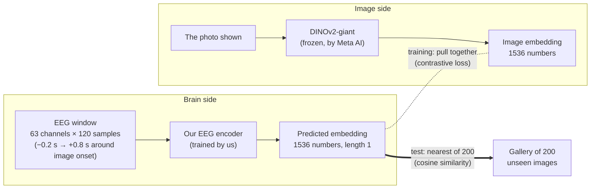
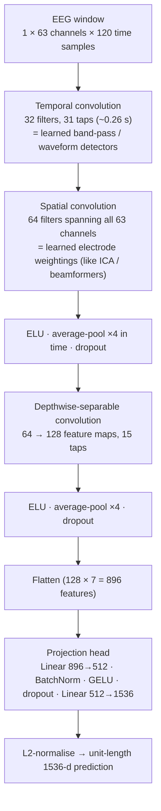
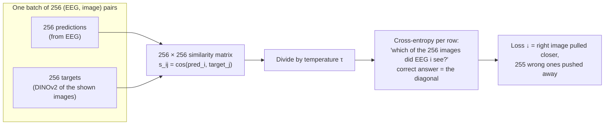
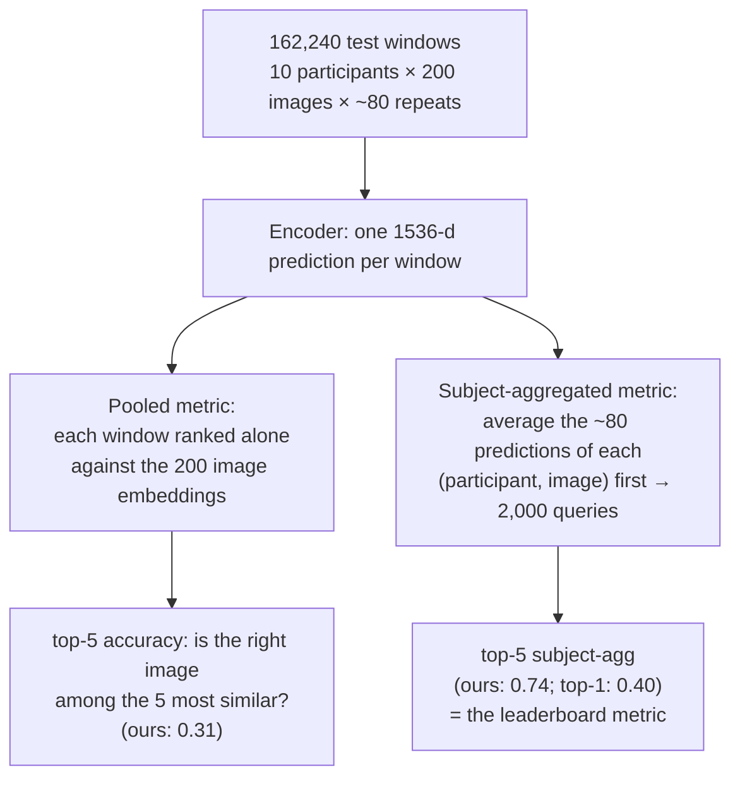

# How it works: EEG-to-image decoding, end to end

A guided tour of what this repo does and why, written for someone who wants to understand it
deeply. Read it top to bottom once; the diagrams are a map you can come back to. For the
layer-by-layer details, the full experiment log and the paper map, see
[architecture_deep_dive.md](architecture_deep_dive.md).

---

## 1. The problem in one sentence

A person looks at a photo while we record their EEG for one second. From that EEG alone, we
must say **which photo they saw**, out of 200 photos the model has never seen during training.

We don't classify into fixed labels: the test images are of *new* concepts. Instead, we
translate brain activity into the **same vector space as the images** and then look up the
nearest image. That is called **zero-shot retrieval**.

---

## 2. The data: THINGS-EEG2

- **THINGS** is a database of 1,854 everyday object *concepts* (aardvark, abacus, …, zucchini),
  with many natural photos per concept.
- **THINGS-EEG2** (Gifford et al., 2022) recorded **10 participants** watching those photos
  in a **rapid serial visual presentation** (RSVP): one image every 200 ms, with a 63-channel
  EEG cap.
  - **Training set:** 1,654 concepts × 10 images = 16,540 images, each shown **4 times** per
    participant.
  - **Test set:** 200 *other* concepts × 1 image, each shown **80 times** per participant.
- The competition pipeline (NeuralBench) cuts the continuous recording into one **window**
  per image presentation: from 0.2 s before onset to 0.8 s after, filtered,
  baseline-corrected, robust-scaled, clipped, and **resampled to 120 Hz**. So each example is
  a `63 × 120` matrix.
- Window counts in our runs: 668,400 training windows (train + NeuralBench's val split,
  all concepts) and 162,240 test windows.

**Why so many repetitions?** A single EEG trial is extremely noisy: the brain response to
an image is small compared to everything else going on (other neural activity, eye movements,
muscles, line noise). Averaging repeats cancels the noise and keeps the image-locked response.
This one idea comes back three times in this project: the metric (§5), repetition-averaged
training (#17), and ensembling.

### Visual processing in the EEG, in brief

After an image appears, the visual cortex responds within ~100 ms (low-level features:
edges, contrast, colour), and by ~150–300 ms higher areas encode object category and meaning.
Our window (−0.2 → +0.8 s) captures all of it. The occipital and parietal electrodes (back of
the head) carry most of the information, which is why the encoder learns its own *spatial*
filters across channels.

---

## 3. The target: DINOv2 image embeddings

[DINOv2](https://arxiv.org/abs/2304.07193) is a vision model trained by self-supervision
on 142M images. Its "giant" version turns any photo into a **1536-d vector** in which similar
images (same object, similar shape or texture) are close together.

We don't train it. It's a fixed "coordinate system for images". Our job is only to map EEG
into that coordinate system. Because DINOv2 places *any* image, including the 200 unseen test
images, in that space, a good EEG→DINOv2 mapping transfers to new concepts. That's what makes
zero-shot possible.

The embeddings are computed once and cached (`cache/`); `scripts/mps_patch.py` computes
them on the Mac's GPU.

---

## 4. The model and how it learns

### 4.1 The encoder (`submission/submission.py`, `EEGToImageEncoder`)

A small convolutional network in the **EEGNet** family (Lawhern et al., 2018), about 1.4M
parameters:

- **Temporal then spatial convolutions** mirror how EEG is analysed by hand: first filter
  in time (which rhythms and waveforms), then combine electrodes (where on the scalp).
- **Pooling** reduces 120 time samples to 7: the response is slow, so fine timing matters
  less than the overall shape.
- **The head** maps EEG features into DINOv2's 1536-d space.
- **Normalisation** puts every prediction on the unit sphere, so only its direction matters,
  matching the cosine-similarity metric.

Issue #27 makes the widths configurable (`temporal_filters`, `spatial_filters`, …, plus
ATM-style residual blocks) to test whether the model is too small.

### 4.2 The loss: contrastive learning (CLIP / InfoNCE)

The naive approach would be to minimise the distance between prediction and target
(regression). It works poorly here: the EEG can't predict all 1536 numbers, and the model
learns to output a blurry "average image". What we actually need is that **the right image
ranks above the wrong ones**. Contrastive learning optimises exactly that:

This is the **InfoNCE** loss (van den Oord et al., 2018), popularised by **CLIP** (Radford
et al., 2021) for images and text, and used for brain decoding by Défossez et al. (2023) and
Benchetrit et al. (2024) at Meta, and by NICE / ATM on THINGS-EEG2.

**The temperature τ** controls how sharp the softmax is. Small τ means the loss focuses on
the hardest wrong images (the ones that look most like the right one). CLIP *learns* τ, with
a floor at 0.01. Learning it instead of fixing it at 0.07 was our biggest single gain
(**+10 points** held-out). In R6, τ fell to the 0.01 floor by epoch 15, so R15 tried a lower
floor (`min_temperature=0.005`): τ went lower, but the held-out score didn't improve, so the
floor stays at 0.01.

**Batch size matters** because the other 255 items are the "wrong answers": more negatives
make a harder, more informative task. That's one of the #18 experiments (batch 512 / 1024).

### 4.3 The optimiser and training loop (`Solver.fit`)

- **AdamW** (Loshchilov & Hutter, 2019) with weight decay 1e-4, learning rate 1e-3, gradient
  clipping at 1.0.
- **Learning-rate schedule** (#18): constant by default; `lr_schedule='cosine'` lowers it
  smoothly to 0 (Loshchilov & Hutter, 2017), with an optional linear **warm-up**. Warm-up
  matters for large batches (Goyal et al., 2017).
- **Per-epoch held-out scoring + early stopping** (#15): after each epoch we score the
  held-out split with the official metric, keep the best epoch's weights, and stop after
  `patience` epochs without improvement.
- **Repetition averaging** (#17, `--avg-reps K`): train on the mean of K repeats of the same
  (participant, image) instead of single noisy trials.

---

## 5. How we're scored

- **Top-k accuracy:** for each query, rank the 200 gallery images by cosine similarity; a hit
  if the right one is in the top k. Chance level is 5/200 = **2.5%** for top-5 and 0.5% for
  top-1.
- **Subject-aggregated** averages a participant's repeated responses to the same image
  before ranking: the same noise-cancelling trick, applied at test time. It's why 0.74 is
  so much higher than the pooled 0.31.

---

## 6. How we choose models without cheating

The warm-up leaderboard is scored on the **public THINGS-EEG2 test set**. Choosing models by
their test score would quietly overfit to it (teams at 1.0 on the leaderboard are almost
certainly leaking test data), and the final phase uses different data anyway.

So we built our own **held-out split that mimics the test set** (`src/data/heldout.py`,
`configs/heldout_concepts.json`):

- 200 *training* concepts are removed entirely from training (no leakage of the concept);
- one image per held-out concept forms a 200-image gallery, as in the test set.

Every decision (temperature, data, epochs, architecture) is made on this held-out score.
The test set is only looked at for the final model, and it has matched Codabench to two
decimals on every upload so far.

```mermaid
flowchart LR
    subgraph Explore["1 · Explore (held-out)"]
        R["Run variants<br/>(R6, R15, R7…R14)<br/>seed 1, 1,454 concepts"] --> HS["Held-out top-5<br/>per epoch"]
        HS --> PICK["Keep changes worth<br/>≥ 1.5 points"]
    end
    subgraph Final["2 · Final models"]
        RT["Retrain the winning recipe<br/>on ALL concepts + val data<br/>3 seeds"] --> ENS["Ensemble: average the<br/>3 normalised predictions"]
        ENS --> TEST["Score once on local test<br/>(= Codabench, to 2 decimals)"]
    end
    subgraph Ship["3 · Ship"]
        ZIP["make zip-submission<br/>submission.py + weights_*.pt"] --> CB["Codabench runs<br/>load_model → predict"]
        CB --> RES["Log in RESULTS.md"]
    end
    PICK --> RT
    TEST --> ZIP
```

**Why retrain on all concepts?** More concepts mean better coverage of DINOv2's space. The
gaps have been consistent: the same model scores 13–16 points higher on test than on
held-out (held-out images were shown ~4 times per participant, test images ~80, so
subject aggregation removes more noise on test), and the all-concept 3-seed ensemble added
about +3 more (R5: 0.5525 held-out → 0.711 test → 0.738 final). That's how we forecast:
0.59 held-out (R6) should land around **0.75–0.78** as a final ensemble.

**Why ensembles help:** different seeds make different errors; averaging their (unit-length)
predictions cancels part of the error. That's the same repetition logic again, applied to
models.

---

## 7. The submission contract

Codabench is **inference-only**: it never trains. We upload a ZIP containing
`submission.py` and the weights. The platform calls `Solver.load_model(meta)` (rebuild the
network for `meta["n_chans"]` channels, load the weights from a read-only folder), then
`model.predict(X)` on each test batch. Since #27, `load_model` reads the layer sizes from the
weights themselves, so the same `submission.py` works for any encoder width or ensemble.

`fit` and `save_model` are only used locally, by `scripts/train_solver.py`.

---

## 8. Where we are (Oct 21)

### Warm-up leaderboard (THINGS-EEG2: same 10 people, 63 channels)

| Date | Change | Held-out top-5 | Codabench top-5 (subject-agg) |
|---|---|---|---|
| Oct 18 | NeuralBench EEGNet baseline | – | 0.29 |
| Oct 19 | Our encoder + CLIP loss, ensemble | – | 0.54–0.55 |
| Oct 19 | **Learnable temperature** | 0.5175 | 0.65 |
| Oct 19 | **+25% data** (NeuralBench's val split) | 0.5525 | 0.71 |
| Oct 20 | Final: all concepts, 3-seed ensemble | – | 0.74 (top-1 0.40) |
| Oct 20 | R6: **40 epochs** instead of 20 | 0.590 | |
| Oct 21 | **Final: R6 recipe, 3-seed ensemble** | – | **0.78 (top-1 0.44)** |
| Oct 21 | R12: **wider convolutions** (64/128/256 filters) | **0.615** | (overnight: 3-seed final, forecast ≈ 0.80) |

No gain, on held-out concepts: temperature floor 0.005 (R15), cosine schedule (R9, 0.570), batch
512 / 1024 with cosine (R10 0.581, R11 0.586: nearly R6's score in 62 instead of 105 minutes),
repetition averaging (R7/R8, cut short by early stopping, to re-test), a wider head only (R13,
trailing, cancelled).

### The final phase: unseen people, 32 channels

The sealed final (Oct 28 – Nov 21) is a private **Alljoined** cohort: **11 new participants,
32-channel Emotiv headset**, new images. We now measure exactly that:

- **THINGS-EEG2 held-out participants** (`--holdout-subjects`, participants 6 and 7 never seen,
  10 galleries): the R6 recipe scores **0.233** on unseen people, against **0.635** when the
  same two people were in training. Unseen people are the main problem.
- **Alljoined-1.6M** (downloaded Oct 21: 20 participants, 32 channels, ~1.66M windows, exactly
  THINGS-EEG2's images): trained on 16 participants, scored on 4 unseen ones over the 200 test
  images: **≈ 0.27** (A1).

What helps on unseen people (THINGS-EEG2, one change each from 0.233):

| Change | Unseen-people score |
|---|---|
| **Per-window normalisation** (`window_norm`) | **0.274** (+4.1) |
| Wider convolutions | 0.253 (+2.0, 3.5× slower) |
| Spatial attention (montage-independent input layer) | 0.255 (+1.6 on average) |
| Augmentation (time shift, channel dropout) | 0.230 (none) |
| Participant-adversarial training | 0.190 (hurts) |
| **Fewer training participants:** 2 / 4 / 6 / 8 | 0.161 / 0.183 / 0.187 / 0.233 |

**More participants is the biggest lever**, so next: joint training on THINGS-EEG2 + Alljoined
(26 people, THINGS reduced to Alljoined's 32 channels), and transfer from **REVE**, an EEG model
pretrained on many people (frozen, with an attention-pooling head). Details in
[architecture_deep_dive.md](architecture_deep_dive.md) §9–§10.

---

## 9. Glossary

| Term | Meaning |
|---|---|
| **Epoch / window / trial** | One image presentation's slice of EEG (`63 × 120` here). *Training* epoch = one pass over all windows; context tells which |
| **Embedding** | A vector representing an item; similar items have nearby vectors |
| **Cosine similarity** | Dot product of unit vectors: 1 = same direction, 0 = unrelated |
| **Zero-shot** | Recognising classes never seen in training, via a shared embedding space |
| **Contrastive loss / InfoNCE** | "Pick the right partner among the batch" cross-entropy |
| **Temperature τ** | Divides similarities before the softmax; smaller = sharper |
| **Held-out split** | Our private test-like validation set (200 training concepts) |
| **Subject-aggregated** | Average a participant's repeats of an image before scoring |
| **Seed** | The random-number start; different seeds give different models from the same recipe |
| **Early stopping** | Keep the best epoch's weights, stop when the validation score stops improving |
| **RSVP** | Rapid serial visual presentation: images flashed in quick succession |

---

## 10. Reading list

The full, checked bibliography (with which references were verified) is in
[architecture_deep_dive.md §7](architecture_deep_dive.md#7-paper-map-and-bibliography).
The arXiv numbers for CLIP, NICE, ATM, Benchetrit et al. and the UBP details could not be
verified offline; search the title if a link doesn't resolve.

### Start here: the core ideas (≈ 1 evening)
1. **Lilian Weng, "Contrastive Representation Learning"** (blog, 2021). The clearest
   introduction to InfoNCE, negatives and temperature.
2. **Radford et al., "Learning Transferable Visual Models From Natural Language Supervision"
   (CLIP, 2021)**, arXiv:2103.00020. Read §2.3 and Figure 3 (the pseudo-code is our loss,
   learnable temperature included).
3. **Song et al., "Decoding Natural Images from EEG for Object Recognition" (NICE, ICLR 2024)**,
   arXiv:2308.13234. *The* paper for our exact setup: THINGS-EEG2, 200-way zero-shot,
   contrastive EEG↔image training. Its results tables are the yardstick.

### Our task specifically
4. **Gifford et al., "A large and rich EEG dataset for modeling human visual object
   recognition" (NeuroImage, 2022)**, doi:10.1016/j.neuroimage.2022.119754. The THINGS-EEG2
   dataset paper: paradigm, preprocessing.
5. **Hebart et al., "THINGS: A database of 1,854 object concepts and more than 26,000
   naturalistic object images" (PLoS ONE, 2019).**
6. **Li et al., "Visual Decoding and Reconstruction via EEG Embeddings with Guided
   Diffusion" (ATM, NeurIPS 2024)**, arXiv:2403.07721. A stronger encoder (issue #12) and the
   residual projection head behind `head_blocks`.
7. **"Bridging the Vision-Brain Gap with an Uncertainty-Aware Blur Prior" (UBP, CVPR 2025).**
   Among the best published THINGS-EEG2 results, and the source of issue #26's blurred-image
   targets.
8. **The Alljoined papers (Xu et al.)**: "Alljoined — A dataset for EEG-to-Image decoding"
   (2024, arXiv:2404.05553) and "Alljoined-1.6M: A Million-Trial EEG-Image Dataset for
   Evaluating Affordable Brain-Computer Interfaces" (2025, arXiv:2508.18571, Emotiv
   headset). The final phase's data family; read before M4.

### Brain decoding at Meta (same recipe, other modalities)
9. **Défossez et al., "Decoding speech perception from non-invasive brain recordings"
   (Nature Machine Intelligence, 2023)**, arXiv:2208.12266. The CLIP loss for MEG/EEG, and the
   subject layer that handles different people.
10. **Benchetrit, Banville & King, "Brain decoding: toward real-time reconstruction of visual
    perception" (ICLR 2024)**, arXiv:2310.19812. MEG→image retrieval with DINOv2-style targets;
    very close to what we do.

### The building blocks
11. **Lawhern et al., "EEGNet: a compact convolutional neural network for EEG-based
    brain–computer interfaces" (J. Neural Engineering, 2018)**, arXiv:1611.08024. Our encoder's
    ancestor; explains temporal → spatial → separable convolutions.
12. **Oquab et al., "DINOv2: Learning Robust Visual Features without Supervision" (2023)**,
    arXiv:2304.07193. What our target space is.
13. **van den Oord et al., "Representation Learning with Contrastive Predictive Coding"
    (2018)**, arXiv:1807.03748. Where InfoNCE comes from.
14. **Loshchilov & Hutter, "Decoupled Weight Decay Regularization" (AdamW, ICLR 2019)**,
    arXiv:1711.05101, and **"SGDR: Stochastic Gradient Descent with Warm Restarts" (ICLR
    2017)**, arXiv:1608.03983 (cosine schedule).
15. **Goyal et al., "Accurate, Large Minibatch SGD: Training ImageNet in 1 Hour" (2017)**,
    arXiv:1706.02677. Linear learning-rate scaling and warm-up for big batches (#18).

### Generalising to new people (added Oct 21; from memory, check titles)
- **Kolesnikov et al., "Big Transfer (BiT)" (ECCV 2020).** More (and more varied) pretraining data
  matters most when the test data differs from training: our "more participants" lever.
- **El Ouahidi et al., REVE (2025).** The EEG foundation model we transfer from (§8, deep dive §10.4).
- **Ganin & Lempitsky (2015), DANN, and Tzeng et al. (2015), domain confusion.** Adversarial
  domain invariance, which we tried for participants (it hurt: deep dive §10.3).

### EEG fundamentals (if the neuroscience side is new)
16. **MNE-Python tutorials** (mne.tools): "Overview of MEG/EEG analysis", epochs, evoked
    responses. Hands-on, with the same concepts as our pipeline (filtering, epoching,
    baseline correction).
17. **Steven Luck, *An Introduction to the Event-Related Potential Technique*** (MIT Press).
    Why averaging repeats works, and what the visual responses (P1, N1, N170…) are.
18. **Mike X Cohen, *Analyzing Neural Time Series Data*** (MIT Press, 2014). Filtering,
    time-frequency, spatial filters; very readable.

### Suggested order
Weng's blog → CLIP §2.3 → NICE → this doc's §4–6 again → EEGNet → Défossez → ATM / UBP →
Alljoined. Then read `submission/submission.py` top to bottom: after these, every line should
make sense.
